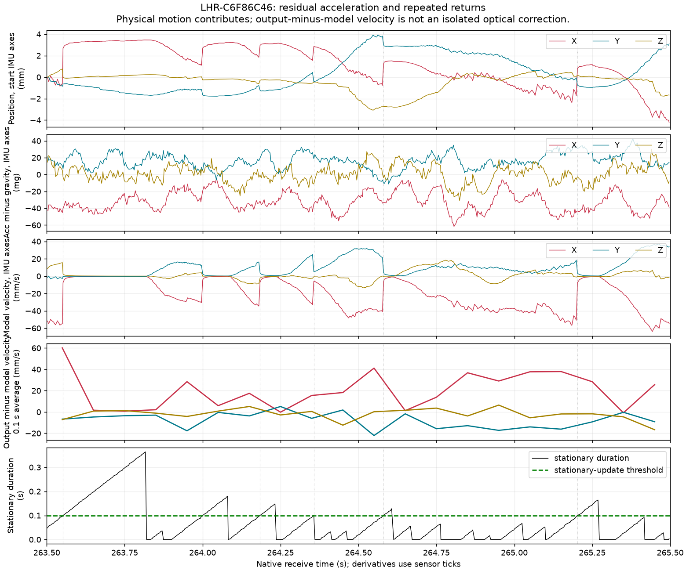

# A の「滑って戻る」動きと IMU 残差の照合

A の Tracker には、加速度残差の方向へ推定速度が育ち、静止拘束の開始時に
逆方向へ位置が戻る波形がある。**260〜266 秒の 15 回の静止拘束開始すべてで、
位置の跳ねは直前の推定速度のほぼ真逆だった。中央値 1.72 mm、最大 3.38 mm。**
バイアス再推定を調べる根拠は強くなった。ただし、この加速度残差はバイアスだけでなく
姿勢・重力方向の誤差も含む。原因を一定の IMU バイアスに限定する結果ではない。

[機械可読結果・入力 SHA・全イベント](lighthouse-body-drift-results-20261025.json) ／
[再集計ツール](../tools/lighthouse_body_drift.py)。追跡処理の変更を含まない解析である。

## 入力と対応付け

- A: `~/LH-Dump/2026-10-25_211424_libsurvive_158643023_1366788`
- Tracker: **`LHR-C6F86C46`、A では WM2**。B では別の native 名なので serial で特定した。
- 記録時の libsurvive は `9f3919c`、角速度プロセス雑音は 60、bias Q は各 `1e-8`、full state。
- 既存の libsurvive 自身の較正を使用。追加予測は 0 ms。
- A は終了がハングして SIGKILL され、gzip EOF trailer がない。完全な記録とは扱わない。
  読めた完全行 3,869,497 行、末尾 receive 310.953457 秒の範囲を解析した。
  元データ、manifest、較正ファイルを変更していない。

Tracker の `POSE_STATE` 67,026 件のうち、`POSE_BIAS`、`POSE_BIAS_VAR`、
calibrated `I`、`VELOCITY` を同じ full sensor tick で対応付けられた 66,925 件を使用。
`I` の 32 bit tick は直後の `INPUT_TIME` と照合して full tick に戻した。
対応しない 101 件を近傍サンプルで埋めなかった。
各評価区間の sensor/receive 間隔は 20 ms 以下で、欠落をまたぐ外挿はしていない。

手持ちマーカーは native receive 約 213.683 秒、低速移動マーカーは 235.176 秒。
下記の細分区間は波形を見て選んだ診断区間で、独立したベンチマークの分割ではない。
低速移動区間には向きを変える動作と小さな動きの区間も含まれている。
マーカーは動作の指示であり、物理的な静止・位置の ground truth ではない。

WiVRn の最新 A/B 引継ぎでは **B=0.6 は不安定で A が好まれた**。
以前の再生結果を理由に 0.6 を既定値へ採用しない。今回も A=60 を調べた。

## 加速度残差と反対向きの補正

以下を IMU 本体座標で計算した。`q` は床・持ち手変換前の `POSE_STATE` の wxyz。
今回の `IMUCorrection` は恒等回転である。

```text
corrected_acc = (calibrated_I.acc - AccBias) / AccScale
residual_acc  = corrected_acc - R(q)^-1 [0, 0, 1]
output_v      = adjacent_raw_position_difference / sensor_tick_delta_seconds
feedback_v   = R(midpoint_q)^-1 (output_v - mean(adjacent_model_VELOCITY))
```

`residual_acc` は重力との差で、実際の並進加速度も含む。1 mg は 0.001 g。
`feedback_v` は出力位置の微分とモデル速度の差である。光学・IMU・静止拘束などの
更新と出力時刻の効果が混ざるため、単独の光学 innovation とは呼ばない。
微分は 48 MHz の sensor tick、区間選択は receive 秒で行い、速度の平均は sensor dt で重み付けした。

| receive 区間 | 本体加速度残差 XYZ の平均 (mg) | モデル本体速度 XYZ の平均 (mm/s) | 出力との差 `feedback_v` XYZ の平均 (mm/s) |
|---|---|---|---|
| 手持ち 219〜227 s | −1.83, +4.49, −3.30 | +1.56, +6.29, −7.92 | +1.01, −4.36, +3.59 |
| 手持ち 229〜235 s | −2.70, +11.70, −2.16 | −5.13, +18.54, −0.66 | +2.71, −10.65, +2.19 |
| 向きを変えた後 260〜266 s | −34.86, +16.01, +0.15 | −16.82, +5.78, +1.23 | +14.92, −6.61, −0.56 |

各区間で残差平均と `-feedback_v` の方向余弦は 0.9886、0.9996、0.9994。
229〜235 秒の本体 Y 出力速度は平均 +7.89 mm/s で、モデルの +18.54 mm/s を
差分の −10.65 mm/s が打ち消す関係にある。
同じ推定系の内部比較なので、方向の一致だけで物理的な誤差量や原因を確定しない。

## 静止拘束の開始と、繰り返す戻り

`survive_kalman_tracker_integrate_imu()` は静止判定が **100 ms を超える**と
速度・角速度・加速度をゼロへ寄せる観測を入れる。観測行列はこれらの状態に対応するが、
Kalman 更新は状態間の共分散を通じて位置・姿勢にも影響できる。
単に速度の出力値だけをゼロにする処理ではない。

260〜266 秒の対応は以下のとおり。

| 指標 | 値 |
|---|---:|
| 静止判定が ≤100 ms → >100 ms になった回数 | 15 |
| その隣接位置ステップの中央値 / 最大 | 1.721 / 3.379 mm |
| それ以外の隣接位置ステップの中央値 | 0.0635 mm |
| ステップと直前速度の逆方向との方向余弦 | 全 15 回で 0.9943 以上 |
| 全 15 回のステップの本体 X 成分 | 正 |
| 全隣接位置ステップの二乗和に占める 15 回の割合 | 63.9% |

最後の割合はこの 6 秒の出力ステップの指標であり、位置誤差やジッター全体の寄与率ではない。
静止判定の開始と一致する観測であり、各更新を無効化した因果分離実験ではない。
この区間にも光学角度 `B` は 6,802 件あり、LH 0 / 1 から各 3,236 / 3,566 件、
入力の最大 receive 間隔は 16.1 ms。光学入力が全面的に途絶した区間ではないが、
各観測が採用されたことまではこの件数から判断できない。

最大の例は native receive **263.550399 → 263.552427 秒**。
sensor tick は **13069952000 → 13070144000**、sensor dt は **4 ms**。

- 位置は直前 IMU 座標で **[+3.283, +0.203, −0.770] mm**、ノルム **3.379 mm** 戻る。
- モデル本体速度は **[−54.54, −2.76, +15.59] → [−7.57, −0.46, +2.56] mm/s**。
- 直前の加速度残差は **[−45.21, +10.39, +5.09] mg**。
- 姿勢も **0.402°** 変わる。その時点の corrected gyro ノルムは **0.0520 rad/s**
  （4 ms 分は約 0.012°）。出力の変化を gyro の積分だけでは説明しにくい。



図は見やすい 263.5〜265.5 秒を切り出したもの。
上から、開始時の IMU 軸で見た位置変化、加速度残差、モデル本体速度、出力との差、静止判定時間。
100 ms を超える開始点で、負方向に育った X 速度と位置が正方向へ戻る。
開始座標での位置変化には実際の手の移動も含まれる。

## バイアス再推定について分かったこと

**静止中の bias 学習は既に動いている。** 202〜212 秒の静置では、factory gyro RMS
0.0207 rad/s に対して残差 bias 適用後は 0.00653 rad/s。
適用後 gyro のベクトル平均のノルムは約 0.000066 rad/s で、
この区間の一定ジャイロ成分はかなり補正されている。

一方、229〜235 秒は Y 加速度残差が平均 +11.70 mg なのに、Y AccBias の変化は
**−2.849 → −2.808 mg（+0.041 mg）**に留まる。
275〜285 秒には静止判定が全サンプルで有効となり、X AccBias は
**+15.35 → +5.20 mg** と約 10 mg 更新される。
残差加速度が存在しても、静止拘束で速度がほぼゼロなら位置は静かに見える、という
ユーザーの「完全静止なら止まるが、手に持つと目立つ」と整合する。

ただし、手持ち平均をそのまま bias に足すことはできない。
記録された姿勢を正解、物理加速度をゼロと仮定した「必要な一定 bias」は、
229〜235 秒で約 **[+20.85, +8.73, +34.01] mg**、
260〜266 秒では約 **[−14.73, +15.30, +36.08] mg** と異なる。
両区間の開始姿勢の差は約 158°。A 全体で一定の本体方向・一定量の bias が
滑りを説明できた、という結論には達していない。

横向きの残差には、加速度の bias/scale と、推定姿勢の傾きからの重力漏れが混ざる。
例えば 35 mg 程度の横成分は約 2° の傾きでも生じ得る。
光学モデル・較正との不一致、姿勢の観測補正も同時に調べる必要がある。
手持ちの実動作を bias として学習させると、逆に追従を損ね得る。

次に libsurvive 内で因果分離すべきなのは以下の 2 点。

1. 信頼できる静止区間の残差を、姿勢・scale の不確かさを考慮して bias へ反映する方法。
   複数姿勢での静止と微小運動で、推定値の保持・収束・動作の消失を確認する。
2. 静止拘束の直前・直後の位置／姿勢／速度／bias と共分散を記録し、
   100 ms 開始時の位置の跳ねを分離する方法。bias 学習と拘束の入り方を比較し、
   完全静止時の安定性も同じ入力で検証する。

以前の全長再生では、静止拘束の単純無効化は静置変動を増やした。
今回の関連が見つかったことだけを理由に、拘束の削除や手持ち加速度の再正規化を採用しない。

## 再集計と検証

Python 環境に NumPy と Matplotlib が必要。今回使用した版は NumPy 2.5.4、Matplotlib 3.11.2。
解析ツールと合成信号の検証は追跡本体と独立している。

```sh
python tools/lighthouse_body_drift.py \
  ~/LH-Dump/2026-10-25_211424_libsurvive_158643023_1366788 \
  --serial LHR-C6F86C46 --allow-truncated-prefix \
  --window desk:202:212 --window held-1:219:227 --window held-2:229:235 \
  --window turned:260:266 --window rest-after:275:285 \
  --window desk-after:293.55:295.8 \
  --output /tmp/A-body-drift.json \
  --plot /tmp/A-body-drift.png --plot-window 263.5:265.5

python tools/test_lighthouse_body_drift.py
```

検証では、既知の回転行列、非 1 の scale と既知 bias、重力、一定速度、
既知の位置ステップ、32 bit tick wrap、quaternion 符号反転、欠落 tick、20 ms 超の欠落、
gzip 終端欠損の拒否／明示 prefix 読み取りを確認した。
公開ツールの数値は別の局所集計と一致し、対の速度平均を dt 重み付けへ統一した。
元記録の SHA は読み取り前後で一致した。
