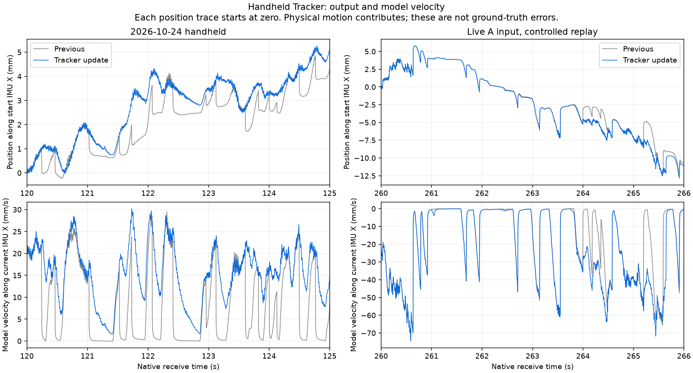

# 手持ち微小運動を残す追跡処理への変更

短い静止判定で速度を強くゼロへ戻す処理を変更した。
**既定で、汎用 Tracker の安定した光学追跡中の静止拘束を段階的に導入し、小さな速度・加速度と
IMU が検出する回転に余地を残す。** Index などの controller と HMD には従来の拘束を保つ。
出力位置への後処理フィルタや追加予測ではない。
光学追跡の獲得中や大きな補正の直後は従来の拘束を使う。

[機械可読結果・コマンド・SHA](lighthouse-handheld-tracking-results-20261025.json) ／
[WiVRn 実測への引継ぎ](libsurvive-handheld-tracking-handoff-20261025.md) ／
[出発点となった A の調査](lighthouse-body-drift-results-20261025.md)。

## 採用した処理

従来の activation detector は、遅い回転や小さな並進でも静止判定を維持し得る。
その判定が 100 ms を超えた瞬間に、速度・角速度・加速度のゼロ観測が強く入っていた。
Kalman の状態間の共分散を通じて位置も変わり、滑って戻る波形につながる。

変更後の既定値は以下のとおり。

| オプション | 既定値 | 意味 |
|---|---:|---|
| `kalman-zvu-stationary-ramp` | 0.5 s | 100 ms の検出後、拘束の情報量を滑らかに増やす期間 |
| `kalman-zvu-stationary-velocity-sigma` | 0.1 m/s | 導入直後に許容する並進速度の不確かさ。期間終了時にゼロへ減る |
| `kalman-zvu-stationary-gyro-scale` | 0.02 rad/s | 残差 bias を引いた gyro が動きを示す場合の拘束緩和の尺度 |
| `kalman-zvu-motion-guard-time` | 0.5 s | 光学追跡が落ち着いてから緩和を許可するまでの時間 |
| `kalman-zvu-motion-all-devices` | OFF | controller / HMD への適用も試す実験用設定。今回は使わない |

拘束の情報量は、導入期間の割合 `u` に対する `u²(3−2u)` で増やす。
期間中の並進速度の標準偏差を `0.1(1−u)` m/s とし、対応する加速度の不確かさも
観測共分散へ加える。加速度が静かなことを、並進速度がゼロである証拠として使い切らないためである。
小さな実回転がある場合には、corrected gyro のノルムに応じてゼロ観測の情報量を減らす。
通常の Kalman 更新へ共分散 `R` として渡し、状態だけを戻したり、共分散の一部だけを消したりしない。

対象は libsurvive の `SURVIVE_OBJECT_TYPE_OTHER`（Vive Tracker を含む汎用機器）。
controller / HMD まで適用する設定は実測の根拠が不足しているため既定 OFF とした。
最初の 16 個の姿勢観測、および予測と光学姿勢の差が 20 mm または 0.1 rad を超える場合を
追跡が落ち着いていない状態として記録する。その後 0.5 秒は従来の静止拘束を保つ。
この判定は観測の棄却や基地局較正の採否には使わない。
activation detector 自体や GSS の較正条件、既存の no-light 拘束は変更していない。

静止が続き、corrected gyro がゼロなら、導入期間後は従来の強さへ到達する。
gyro のノイズがある実データでは強さは厳密には同一ではない。
角速度プロセス雑音は **60**、bias Q は各 **1e-8** のまま。
IMU の加速度を 1 g へ再正規化する処理や、SteamVR の較正のインポートは追加していない。

## 既知の微小運動での追従確認

実際の追跡関数へ、250 Hz の IMU と 50 Hz の既知の姿勢観測を入れた。
真の位置は振幅 2 mm、0.5 Hz の正弦波。回転ありの場合は同位相の振幅 0.02 rad の回転も与える。
300 ms 周期で短い静止検出を作り、その間も真の運動を継続させる。
光学の姿勢観測はノイズなし。4 秒の立ち上がり後の 16 秒で集計した、制御された合成試験である。

| 試験 | 従来 | 採用版 |
|---|---:|---:|
| 回転を伴う微小運動の位置誤差 RMS | 1.052 mm | 0.077 mm |
| その位置の振幅比 | 65.7% | 104.2% |
| その姿勢誤差 RMS | 0.0203° | 0.00280° |
| 回転を伴わない微小並進の位置誤差 RMS | 1.080 mm | 0.087 mm |
| その位置の振幅比 | 65.2% | 104.2% |

「動きを縮めて静かに見せる」変更にならないよう、位置・角度の振幅を 5% 以内で保つこと、
位置誤差 RMS <0.1 mm を回帰テストにした。
これは合成入力に対する誤差であり、実機で同じ誤差を達成したという意味ではない。

## 実記録の全長再生

### A: 2026-10-25 21:14 の読み取れる約 311 秒

`2026-10-25_211424_libsurvive_158643023_1366788` の完全な入力行を評価用 gzip へ取り出し、
libsurvive 自身の immutable initial calibration を各試行用 config にコピーした。
元の A は SIGKILL で gzip 終端がなく、完全な記録として扱わない。
入力コピーでは出力姿勢・診断値と `LH_POSE` を除外し、raw IMU、sweep/sync、工場較正を使った。
GSS は固定較正の比較では無効、poser は直列、追加予測・追加床追従なし、状態次元を固定した。
CLI 再生と live のスレッド実行は一致しないため、同じ入力内での比較である。

以下は Tracker `LHR-C6F86C46`、A では WM2。
200 Hz の sensor-time グリッドに補間し、中心 101 点平均を引いた位置の変動 RMS。
**実際の手の動きも含む出力変動であり、位置誤差や純粋なノイズ量ではない。**

| receive 区間 | 従来 | 採用版 |
|---|---:|---:|
| 静置 202〜212 s | 0.00754 mm | 0.00761 mm |
| 手持ち 229〜235 s | 1.1391 mm | 1.1379 mm |
| 向きを変えた後の小さな動き 260〜266 s | 1.1275 mm | 0.9668 mm（約 14% 減） |
| 後半の静止 275〜285 s | 0.00868 mm | 0.01253 mm |

260〜266 秒の静止開始時の位置ステップ中央値は約 2.006→1.605 mm。
最大は約 3.617→3.619 mm と改善していない。光学追跡が落ち着かないと判定した時は
従来の拘束へ戻すため、すべての戻りが消える変更ではない。
この基準での「光学追跡が安定」は独立した物理的な静止判定ではない。

既定値での全長再生とその繰り返し、明示的な採用設定の再生について POSE ハッシュを照合した。
旧拘束の制御条件は `kalman-zvu-stationary-ramp=0` と `kalman-zvu-stationary-gyro-scale=0`。
採用版 A の左右 Index の全 POSE ハッシュは変更前と一致した。
同じ最終バイナリの旧拘束の制御条件は、変更前の全デバイスの POSE ハッシュと一致した。

### 前日の手持ち記録: 新規較正から約 125 秒

`2026-10-24_203705_libsurvive_907114938_814822` を、新規 config、GSS 有効・直列で全長再生した。
入力コピーから元記録の NUL を含む 2 行を除いた、前回と同じ入力を使った。
元記録の破損を直したという意味ではなく、欠けた IMU を復元してもいない。

Tracker の 120〜125 秒の位置変動は約 **0.4777→0.4567 mm**、角度変動は **0.2147→0.2108°**。
静止開始時の位置ステップ中央値は約 **0.808→0.089 mm**、最大は約 **1.169→0.147 mm**。
55〜80 秒の静置の位置変動は約 0.00564 mm のまま。
この記録では Tracker の native 名は WM0 であり、A と取り違えていない。



左は前日の手持ち区間、右は A。灰が変更前、青が採用版。
各位置系列は開始時の IMU X 軸で表し、開始位置をゼロにした。
実際の手の動きを含み、正解位置との差を示す図ではない。
左では強い速度ゼロ拘束による戻りが減り、右では従来の拘束へ戻す箇所も残る。

### BS 1.0 / 2.0 の動作記録

USB 入力から、新規 config と libsurvive 自身の較正で各記録を全長再生した。
SteamVR 出力との held-out 比較は 50 Hz、前半 1/3 で SE(3) を合わせ、時間ずれをフィットしない。
参照は独立した物理 ground truth ではなく、以下も参照との差である。

採用版を含む最終数値・coverage・コマンドは JSON に保存した。
BS 1.0 は `2026-10-20_125408_406716137_53614`、
BS 2.0 は `2026-10-23_223843_281852543_236227`。
BS 2.0 の差分 RMSE は丸めた桁では DF 8.87 mm / 2.351°、F39 8.44 mm / 1.987°のまま。
BS 1.0 は 5D が約 62.325→62.325 mm / 1.9489→1.9488°、
DF が約 114.417 mm / 2.7560°、F39 が約 81.302 mm / 2.6071°。
両記録とも評価対象の各機器の coverage は変更前と同じだった。
最新コードで LH-Dump 全量を再評価した結果ではない。

## 採用しなかった試作と残る問題

- 光学の安定確認なしで拘束を緩める試作は、Tracker の戻りを大きく減らした一方、
  A の一部の Index の大きな跳びを増やした。そのまま既定値にはしなかった。
- 安定確認を加えても controller の一部の初期区間の跳びが増えたため、
  採用版は汎用 Tracker に対象を絞った。Index と HMD は従来の拘束を維持する。
- 光学姿勢の normalized innovation に応じて共分散を広く増やす試作は、
  BS 1.0 の動作評価を悪化させたため、実装を取り除いた。
- bias Q を増やすだけの試作は、後半の残差を減らす区間があっても効果が混合し、採用しなかった。

同じ姿勢を表す quaternion `q` と `-q` の差をそのまま観測残差にする不整合も確認した。
符号を予測姿勢へ揃え、位置・回転の共分散の交差項も反転する実装と回帰テストを追加したが、
**`kalman-align-observation-quaternion` は既定 OFF の試験用**とした。
数学的な表現の不変性は満たす一方、A の一部の Index の大跳びが増えたためである。
この試作を採用版の改善として数えない。今後の姿勢観測モデルの調査用に残している。

Index の大きな姿勢・位置の跳びは既存の問題として残っている。
今回の変更が SteamVR と同等の追跡性能を達成した、あるいは手持ちの滑りを解消したとは言えない。
実機での体感・動き始め・停止後の滑りは、WiVRn への反映後に確認する必要がある。

## 検証と再集計

関連 CTest 16/16。静止開始・十分な静止・光学復帰時の拘束、no-light、微小並進／回転、
quaternion と共分散の符号整合をテストした。主要 3 テストは ASan/UBSan と leak 検出でも成功。
符号修正を有効にした表現の不変性テストは、互換の修正前実装では失敗することを確認した。

```sh
python tools/lighthouse_stationary_metrics.py \
  .lh-evaluation/handheld-fix-2026-10-25/tracker-final/record.rec.gz \
  --serial LHR-C6F86C46 --window desk:202:212 \
  --window held:229:235 --window turned:260:266 --window rest:275:285 \
  --output /tmp/handheld-tracking-metrics.json
```

NumPy が必要。フィルタの追跡コード自体に Python 依存を追加したわけではない。
native 出力、固定バイナリ、入力コピー、全試作の実行ログ・集計は
`.lh-evaluation/handheld-fix-2026-10-25/` に保持している。
