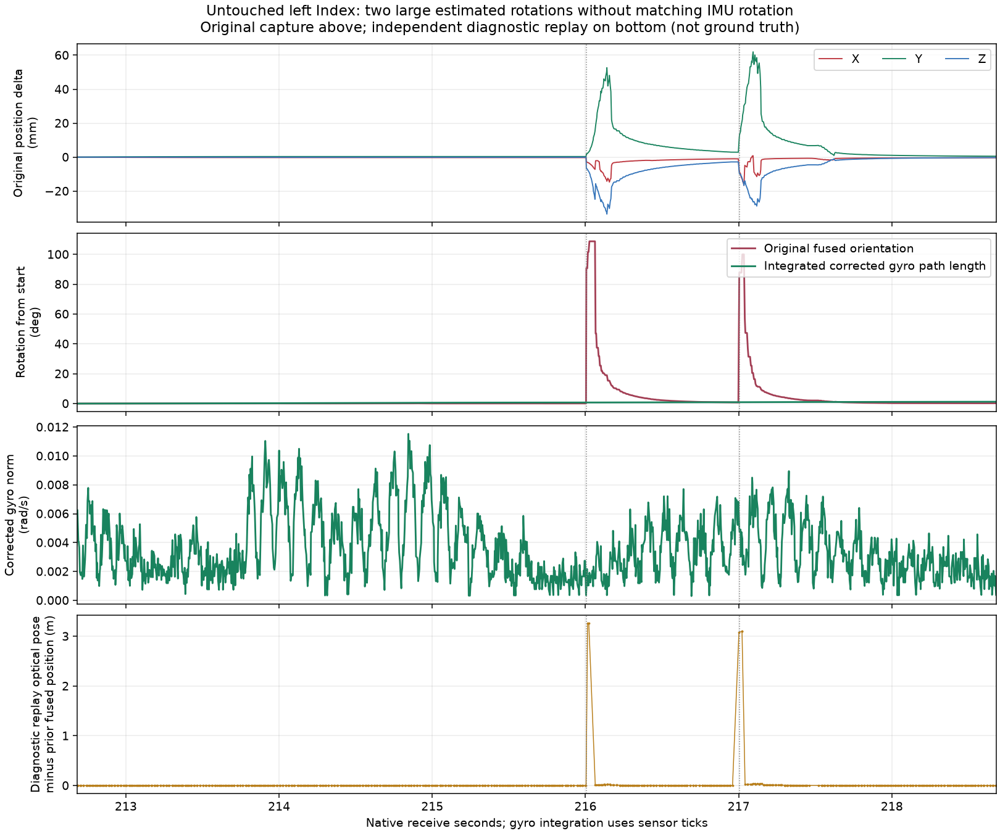

# 静置した左 Index の二回の揺れ

共有された A の **212.683011–218.683011 秒**には、IMU に対応する回転がないのに
推定姿勢が約 90 度飛び、その後に位置が約 6–7 cm 流れて戻る現象がある。
光学解の外れ値と融合処理を調べるべき事例である。

[数値・入力 SHA・診断リプレイのコマンド](lighthouse-index-rest-review-20261026.json)。

## 元記録との照合

- ダンプ: `2026-10-25_211424_libsurvive_158643023_1366788`
- native SHA-256: `b3ec6f2a0b4d2fb76cc72eeccf04041801986223fe74e589e363ba1b48329f01`
- serial: `LHR-F39A0C97`、native 名 `WM1`。
  CONFIG は manufacturer `Valve`、model `Knuckles Left`。**左 Index コントローラー**。
- 床補正前の `POSE_STATE` 1,503 件。full tick は共有情報と同じ
  `11534850048–11822554624 @ 48000000 Hz`。
- 元の gzip は EOF trailer がない readable prefix。元データを変更せず、
  全ファイルの SHA が共有情報と一致することを確認して区間を解析した。

位置・姿勢のステップは隣接する full tick 間で計算した。
quaternion の角距離は `q` と `-q` を同じ回転として扱う。
ジャイロは同じ tick の calibrated `I` から `POSE_BIAS.GyroBias` を引き、
隣接二標本の平均を sensor dt に掛けた値である。

| native receive 秒 | sensor dt | 推定姿勢の隣接変化 | ジャイロ相当の変化 | 隣接位置ステップ |
|---|---:|---:|---:|---:|
| 216.003778 → 216.005782 | 3.989 ms | **90.704°** | 0.000066° | 7.345 mm |
| 216.997876 → 217.003863 | 3.989 ms | **87.106°** | 0.001357° | 13.048 mm |

区間先頭からの姿勢差は、それぞれ最大 **108.757° / 100.028°**。
続く位置変位は最大 **64.026 mm（216.139742 秒）/ 67.377 mm（217.093986 秒）**。
各イベント前後の calibrated 加速度の向きの変化は最大約 0.39° / 0.42°だった。
これは物理的な静止の独立測定ではないが、大回転する出力と IMU が一致しない。

隣接 quaternion の内積は +0.703 / +0.725。
単なる quaternion 符号反転や回転グラフの ±180° 境界で生じた表示ではなく、
元の推定姿勢に実際の角距離を持つジャンプがある。
この範囲の IMU sensor gap は最大 3.995 ms、pose receive gap は最大 9.620 ms。
区間内に `LH_POSE` の更新はなく、全体の座標変換・床補正で説明する所見でもない。

上三段は元記録。最下段は別途行った診断リプレイで、真値との距離ではない。
ジャイロ積分の線は回転経路長の累積であり、出力との一致を強制した角度ではない。

## 光学入力と静止判定の対応

一回目の直前、**216.003837 秒**の `B` は
`channel=0, sensor=4, plane=1, tick32=3104053906, angle=-0.7406361 rad`。
同じ channel / sensor / plane の直前の raw `B` は 215.927764 秒、
`+1.182512 rad` で、差は **−1.9231481 rad（約 −110.19°）**。

この `B` の tick を復元した **11693988498** は、次の POSE_STATE に記録された
`last_movement_tick` と正確に一致し、同 tick の IMU 標本はない。
静止判定時間も **3.750 秒 → 4.776 ms** へ戻っている。
光学入力の更新に対応して静止判定が解除されたことを示す。
二回目周辺の `last_movement_tick` の更新も `B` の tick に対応する。

`B` は採用・棄却双方の入力を記録する。隣接 raw 角度の差をすべて採用済み innovation
として扱うことはできない。全区間では channel 0 が 2,489 件、channel 14 が 3,925 件あり、
最後の受光からの sensor-clock age は最大 17.985 ms。
受光が全面的に途絶した事例としては扱わない。

## 光学ソルバー出力を記録した診断リプレイ

既存の A raw 入力の最初の 225 秒を、凍結した `baseline-bin`、元の libsurvive
`calibration.initial.json`、single-threaded poser、GSS 無効の条件で再生した。
`--report-in-imu --show-raw-obs` によって、同じ IMU 参照点・床補正前の座標で
`WM1-raw-obs EXTERNAL_POSE` を追加記録した。Valve の較正をインポートしていない。

診断を加えた replay の 200–225 秒の全 **6,265 POSE_STATE** は、既存の baseline replay と
受信秒を除く全フィールドが bit 単位で同一だった。raw observation の記録自体が
結果を変えた事例ではない。

- **216.013868 秒**の光学解は、直前の fused pose から **3.261 m / 92.166°** 離れる。
- **217.001749 秒**の光学解も **3.082 m / 91.015°** 離れる。
- その直後の fused pose に大きな角度のジャンプが出る。
  リプレイのこの区間の最大隣接角度変化は **52.494°**。

元の live 記録は threaded poser で、リプレイと更新順が異なる。
元記録の 90.704° とリプレイの 52.494° を同じ標本・同じ振幅の再現とは扱わない。
元記録には各回の raw solver pose がないため、live でも同じ 3 m の解が出たとまでは確定しない。
ただし、同じ raw 入力と libsurvive 較正で異常な光学解と融合側のジャンプが出ることは確認できた。

既存の `tracker-final` replay も、この左 Index の区間は baseline と同じ出力だった。
汎用 Tracker を対象にした先日の静止拘束の変更では、この Index の問題は解消していない。
既存の `quaternion-only` trial でも最大隣接変化は 52.509°。
この事例を quaternion の hemisphere 整列だけで解決できたという結果もない。

## 「滑って戻る」までの経路

一回目の角度ジャンプ前後で、加速度から推定重力を引いた残差のノルムは
**0.0080 g → 1.3935 g**、二回目は **0.0136 g → 1.3737 g** となる。
実際の加速度入力がこの大きさで増えたわけではなく、記録された姿勢で重力を換算すると
大きな不一致が生じる。モデル速度も育ち、位置が数 cm 流れてから復帰する。
光学による誤った姿勢補正が重力補償を崩す、という経路と整合する。

この二回で優先して調べるのは、光学候補解・その共分散・IMU 予測との不一致を使った
異常候補の拒否と復帰である。反射、遮蔽、ビームの解釈、最適化の別解のどれが
上流の引き金になったかはまだ分離できていない。IMU bias を増減するだけで
90 度級の観測補正を直せる、という根拠にはならない。

## 補助集計の訂正

調査中、`lighthouse_body_drift.py` の Gen2 `B` の分類誤りを発見した。
形式は `channel sensor tick plane angle` だが、以前は plane を LH 番号としていた。
channel と sensor を読むよう修正し、合成 channel 1 / 14・sensor 5 の検証を追加した。
以前の Tracker 調査の文書・JSON も channel 別の件数へ訂正した。
変更対象は光学件数の分類で、総件数・時間間隔・姿勢・IMU・位置ステップの数値は同じ。
追跡ランタイムや起動中のビジュアライザーの変更は行っていない。
