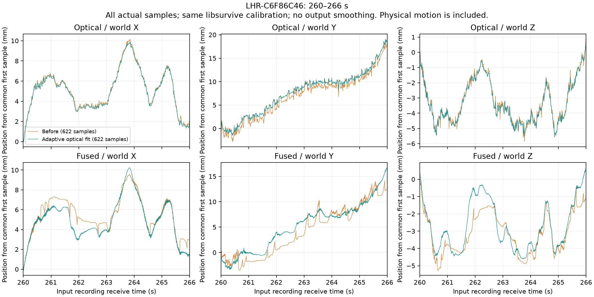

# 光学フィットの改善とダンプ評価（2026-10-26）

A の手持ち区間で、光学フィット自体のばらつきを減らす変更を実装した。
出力姿勢の時間平均、追加予測、Valve の較正インポートは使っていない。
実機での体感と絶対精度は未確認。Index の大跳びや、既知の較正失敗を解決したとは扱わない。

## 実装した候補と既定値

MPFIT の受光角の残差へ Huber 損失を使う。大きく外れた受光が解を引っ張る力を弱め、
小さな残差は従来の二乗誤差のまま扱う。解析 Jacobian にも同じ変換の微分を掛ける。
重力や通常の事前拘束には掛けない。時系列の平均や出力を前の姿勢へ近づける拘束は追加しない。

固定閾値は一部の記録で悪化したため、各 solve の初期受光残差の絶対値中央値から
`max(0.003 rad, 6 × median)` を選び、反復中は固定する。
初期姿勢と受光全体がずれているときに、多くの受光まで低く重み付けするのを避ける。
反復ごとに閾値を動かして、目的関数と Jacobian が食い違う方法にはしていない。

既定は従来の二乗誤差を保つ `mpfit-light-huber=0`。
試験時に `mpfit-light-huber=-1` を指定すると汎用 Tracker に適用する。
Index/controller と HMD は対象にせず、世界較正が確立した後の追跡 solve のみへ掛ける。
初期較正、GSS、基地局を同時に解く solve は従来の損失を保つ。
`mpfit-light-huber=0` で従来の二乗誤差へ戻せる。
正の値は全機種への固定閾値を試す研究用設定。

また、重力拘束が3要素を持つのに、光学残差を測定の「件数」で参照していた誤りを修正した。
重力拘束より後の誤差が2要素ずれ、誤った基地局を除外する場合があった。
この修正は BS 1.0 / 2.0 の合成回帰試験で確認した。

## A の比較

`2026-10-25_211424_libsurvive_158643023_1366788`、Tracker `LHR-C6F86C46`。
同じ入力専用記録と、記録時の **libsurvive 自身の較正**を各試行へコピーした。
GSS と自動床補正を止め、raw IMU 原点、直列 poser、full state、
`process-weight-ang-vel=60` などの他の設定を揃えた。
元の live 出力との直接比較ではなく、変更前後の直列再生の比較である。

| 指標 | 変更前 | Huber -1（試験設定） |
| --- | ---: | ---: |
| 手持ち 260–266 s：光学候補数 | 622 | 622 |
| 同：光学位置の局所残差 p95 | 1.131 mm | 0.628 mm |
| 同：光学回転増分と gyro 積分の差 p95 | 5.520° | 2.589° |
| 同：融合後の最大隣接位置差 | 3.619 mm | 1.036 mm |
| 同：融合後の最大隣接回転差 | 1.284° | 0.693° |
| 持ち上げ 234.176186–240.176186 s：光学候補数 | 921 | 921 |
| 同：光学位置の局所残差 p95 | 1.225 mm | 1.224 mm |
| 静置 202–212 s：光学位置の局所残差 p95 | 0.093 mm | 0.093 mm |

位置の局所残差は、両隣を**実際の不均一な標本時刻**で線形補間した位置と中央標本との差。
一定速度運動ではゼロになるが、実際の加速度も含む。純粋なノイズ量や真値との誤差ではない。
光学と gyro の比較は full sensor tick により同じ計測区間を合わせ、
記録した calibrated gyro から推定 bias を引いて積分する。
隣接姿勢の20 ms超の間隔と、gyro の10 ms超の間隔は積分・接続から除外する。
隣接差には物理的な移動も含まれる。これらは物理入力から表示までの遅延測定ではない。



独立した R4 の125秒の入力を新規較正から再生しても、90–100秒の光学位置局所残差 p95 は
1.159 → 1.071 mm、gyro との差 p95 は 2.092 → 1.958°だった。
改善幅は A より小さい。最終ビルドで従来設定と試験設定の再生を照合し、
融合姿勢・光学候補それぞれの全レコードの SHA-256 が一致することを確認した。
最終ビルドの既定値0は変更前、明示した-1は評価した候補とそれぞれ一致した。

## 評価した範囲

機械可読な数値・ソース／バイナリ SHA・コマンドは
[lighthouse-optical-results-20261026.json](lighthouse-optical-results-20261026.json) に保存する。

- USB 記録73件を全件列挙して前後再生。600秒以下の36件は全量、長い37件は先頭180秒。
  元記録の申告期間は合計17.31時間、今回の再生対象は申告期間からの計算で最大3.25時間／片側。
  **17時間全量の前後評価ではない。** 実際の読取可能期間・出力数は各結果を参照。
- native 7件は読める入力全体を再生。A/R4 に加え、19:34、19:36、19:54、21:29、23:54 の5件。
  壊れた末尾や NUL は入力の証拠に残す。19:54 の入力には NUL 行7件があった。
- USB は各回新規設定から較正する。native は同じ libsurvive 較正 snapshot があれば両側にコピーし、
  なければ新規較正。原記録・元の較正は書き換えない。
- 参照は steamvr_lh の記録で、真値ではない。10秒 warmup 後の最初の1/3だけで共通 SE(3) を合わせ、
  残り2/3を10 Hzで評価。coverage は50 Hz。時間差をフィットしない。
  長い記録の評価区間は出力の有無に依存させず、先頭の clock-sync から事前指定の180秒に固定する。
  欠けた出力や末尾を、自動で評価範囲から取り除かない。

候補の選択に使った記録も含むオフライン比較であり、未使用データだけの検証ではない。
参照の held-out 分割は座標合わせに使う部分と測定する部分を分けるもので、
この開発過程全体のパラメータ選択を独立に検証するものではない。

USB 73件の全146再生は終了コード0で完了し、記録出力に非有限姿勢はなかった。
出力が0だった記録は前後とも26件。これらを精度評価成功の件数には数えない。
全出力姿勢数は3,801,465 → 3,806,549だった。
参照との前後比較ができたのは、記録と serial の組合せで110件。

探索用の判定基準を「位置RMSE増加が max(1 mm, 2%) 超、回転RMSE増加が max(0.05°, 2%) 超、
coverage低下が0.001超」として全件を確認した。6件が基準を超え、coverage低下による超過はなかった。
これは統計的な同等性検定や合格条件ではない。

| 記録 / デバイス | 位置RMSE mm 前→後 | 回転RMSE ° 前→後 |
| --- | ---: | ---: |
| `2026-10-15_212702` / 9338C3A6 | 98.52 → 100.64 | 10.417 → 9.457 |
| `2026-10-23_224637` / 9338C3A6 | 13.45 → 19.84 | 3.584 → 3.326 |
| 同 / 9BB5412D | 17.08 → 21.29 | 1.412 → 1.110 |
| 同 / D8CCD0C5 | 15.86 → 17.80 | 1.629 → 1.507 |
| 同 / DF24384D | 17.07 → 25.40 | 1.467 → 1.552 |
| 同 / F39A0C97 | 17.78 → 24.34 | 2.442 → 2.267 |

参照との整列は各試行の共通 SE(3) なので、他デバイスの変化が整列に影響する場合もある。
これだけで各 Index の光学解そのものが悪化したと断定しないが、全体の参照一致が一様に改善したとは言えない。
また、`224637` では controller の出力ハッシュも前後で異なった。
固定較正の A では変わらなかったが、較正・追跡が連動する通常再生では、
Tracker だけへの適用でも他デバイスへの間接影響が残る。
この結果と既知の不良較正での悪化を踏まえ、**Huber と受光除外はともに既定無効**とした。
`e6e9707` 単独ではなく、既定値を戻した `32848dc` 以降を使う。
既定で反映する追跡変更は `93fccbd` の残差対応修正。
悪化した上記2記録でも、最終ビルドの既定値0へ戻すと全姿勢のハッシュと参照比較値が変更前と一致した。


## 比較して見送った設定

受光の有効期間を短くする方法と、測定年齢による重み付けの強化は、A の微小運動で悪化した。
固定 Huber 閾値も、低くしすぎると持ち上げを悪化させた。
固定3 mradは A の手持ちで良かったが、`2026-10-20_150000` の Tracker の参照回転差が
9.530 → 10.983°へ増えた。初期残差から調整する方式では同条件で9.527°となった。

受光の一部を強制除外する候補も実装・検証した。A の左 Index の報告区間では、
融合後の最大跳びを11.111 mm / 52.494°から0.204 mm / 0.132°へ減らしたが、
右 Index の別区間や複数の USB 記録では悪化した。
この値は除外を有効にした**実験**の結果で、Huber 単独の改善値ではない。
`mpfit-light-outlier-ratio=0` を既定とし、無効のまま残す。
有効にする場合も、直近50 ms以内に解があり、12受光以上、除外25%以下、8受光以上と
2つ以上の基地局／走査面グループが残る条件に限る。
観測配置が十分に良いことを、この条件だけで保証するものではない。

## 限界と実測

A の Index の大きな光学跳びは残る。固定較正の A では controller の出力は変更前と同じ。
19:36 の既知の不良較正を再利用した記録も安定していない。
この記録の Tracker の局所残差 p95 は9.920 → 11.052 mm、gyro との差は11.107 → 11.975°へ悪化した。
改善した記録だけを根拠に、較正の良否・追跡喪失からの回復まで改善したとは判定しない。

時間方向の平均や追加の待機は導入していないが、実機での追従遅れは未実測。
[WiVRn 向けの引き継ぎ](libsurvive-optical-fitting-handoff-20261026.md) で、
同じバイナリ・正常な libsurvive 較正・予測0 msのまま、Huber 0 / -1 の A→B→A を行う。
微小な並進の消失、動き始め、停止・逆転、速い回転後の復帰も確認する。

## 再現と検証

固定した CLI だけでなく、core と全 plugin を対にして使う。
今回のローカル成果物は `.lh-evaluation/optical-2026-10-26/` に保持している。

```sh
python3 tools/lighthouse_optical_benchmark.py \
  --baseline /path/to/frozen-before/survive-cli \
  --candidate /path/to/frozen-after/survive-cli \
  --dumps ~/LH-Dump --output /tmp/optical-audit \
  --reference-cache .lh-evaluation/full-2026-10-24/reference-index \
  --outlier-ratio 0 --huber -1 --jobs 3
```

NumPy が必要。今回は `/tmp/lh-imu-analysis-venv/bin/python` を使った。
出力先は新規ディレクトリを指定する。途中再開はソース・設定・ビルド・解析コードの SHA が
一致するときだけ `--resume` で行う。終了コード0は監査完了を意味し、追跡品質の合格とは別。
標本不足、出力なし、manifest の異常や参照との不一致も結果として確認する。

- CTest 52/53成功。`lh1_test_cal.rec.gz` は変更前バイナリでも同一の
  `rot=0.001202, pos=0.078013` で失敗する既存ケース。
- optimizer / kalman_observation / recording の ASan・UBSan・leak検査は3/3成功。
- 比較器18件、viewer 17件、光学評価器4件の Python テスト成功。
- ブラウザで変更前後の622候補、64-bit時計、共有リンク、全67,026標本の全体再生を確認。
  テスト用 HTTP サーバーは終了した。ユーザーの8080サーバーは操作していない。
