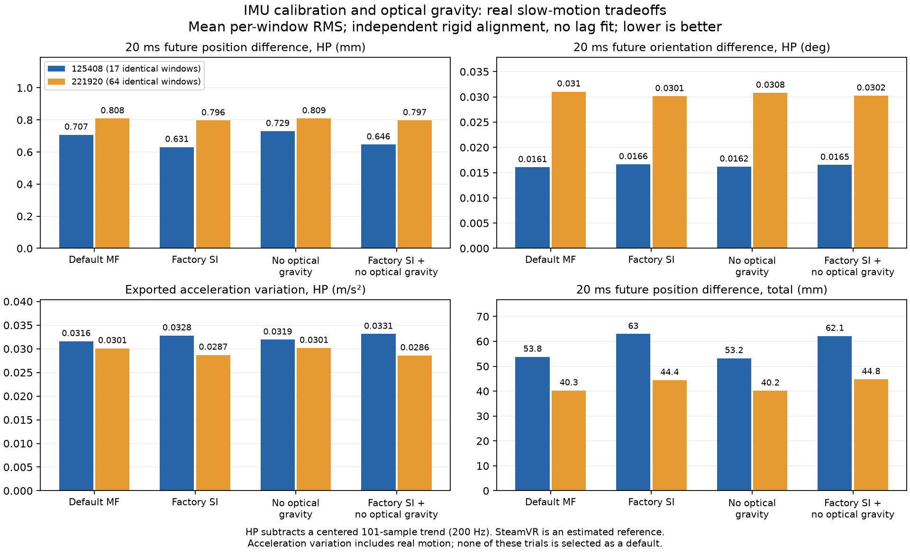
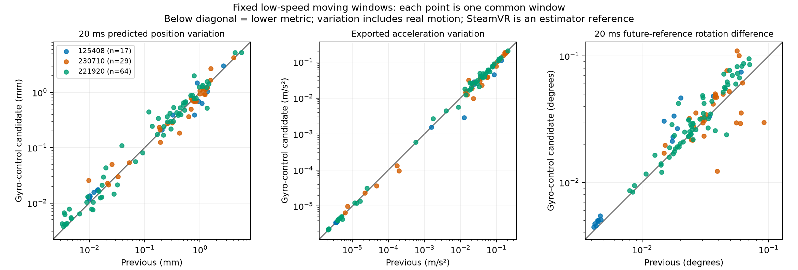

# 低速域の追跡・予測の追加調査（2026-10-27、中間整理）

## 容量整理後の現状

**低速・手持ち・身体装着時のジッター、出力加速度、未来予測をSteamVR相当まで安定させる目標には未達である。**
f8886a2より全体の参照との差が減った集計はあるが、記録ごとの退行が残る。
平均の改善を、ほぼ止まっているときの安定性の改善として扱わない。
以下を最新状態とし、後段の各段階の数値は当時の構成・範囲に対する履歴とする。

| 項目 | 確認できたこと | 残る制限 |
| --- | --- | --- |
| 本体の修正 | 微小回転、姿勢・共分散の座標変換、観測の交差共分散、不良な光学解の扱いを修正 | 数学的な整合や限定した不良観測への効果は、通常の低速ジッターの改善を保証しない |
| 最新本体の再生 | 73件の規定範囲で直前MF finalと出力ストリームが完全一致、実行エラー0件 | 36件は全量、37件は先頭180秒。最新本体の全73件EOF評価ではない |
| 低速・予測 | 出力加速度と10/20/30 ms予測、実際の未来の参照との差を評価できるようにした | 平滑に見えても微動や未来への追従が悪化する試作があり、SteamVR相当の達成を確認できていない |
| 前段階MF finalのEOF評価 | 71件の再生がEOFまで成功、69件の参照比較が完了 | 2件は比較だけがディスクI/Oで失敗、別の2件はEOF再生未完了。実行は終了しており、動作中ではない |
| 試作の採否 | ジャイロ制御、ノイズ調整、較正の変更、光学観測の単純な減重・間引きは既定へ採用しない | 合成条件や一部の窓の改善が、実録全体では退行した |

前段階MF finalの比較成功69件・共通85組では、f8886a2からの変化は次のとおり。
各組のRMSEを平均・中央値にした値で、全標本をまとめたRMSEではない。SteamVRは推定器の参照である。

| 指標 | f8886a2 | 前段階MF final |
| --- | ---: | ---: |
| 位置RMSEの平均 | 180.562 mm | 155.950 mm |
| 位置RMSEの中央値 | 63.514 mm | 56.208 mm |
| 回転RMSEの平均 | 7.537° | 5.716° |
| 回転RMSEの中央値 | 2.839° | 1.805° |

一方、`135619`右コントローラーの位置RMSEは172.540→592.529 mmへ悪化した。
この69件は完了した部分集合で、未完了4件を含む全73件の結論でも、低速ジッターの集計でもない。
最新の灯台共分散・符号修正を加えた本体の全量結果への付け替えもしない。

光学観測では、同じ受光データを再利用した姿勢推定の誤差が時刻間で共有されることを、
実際のソルバーJacobianと受光データの識別子から調べた。
native-Aと同時記録`125408`の計82,828更新で、返却共分散の再構成誤差は最大2.91×10⁻¹¹未満だった。
隣り合う更新の相関だけを合わせる一次モデルでは、native-Aの2更新先の相関を表現し切れない。
これは受光ノイズの仮定に基づくモデル診断で、ジッターの主因を確定したものではない。
個々の受光誤差を保持する融合はまだ未実装で、合成検証も時刻の非単調性を処理する前に停止している。
この調査で追跡出力は変更していない。

容量整理では、元録画・有効な再生記録・JSON/CSV集計・ログ・固定ソースとバイナリを残し、
比較・表示用SQLite 3,611件、約117.5 GiB分を削除した。共有の参照インデックス73件は残した。
`~/libsurvive`は約310.6→193.1 GiB、ファイルシステムの空きは約1.5→104 GiBになった。
別に`/tmp`の不要な旧ビルドと失敗した途中記録を約2.8 GiB整理した。
削除台帳は機械可読結果の`storage_cleanup_20261027`から参照できる。
残る容量の大半は再生記録で、比較をやり直す場合、削除したSQLiteは再生成が必要になる。

保存量を抑える比較用インデックスも追加した。全センサー時刻を圧縮した小分けファイルで整列し、
50 Hzへ写した行だけをDBへ保存する。既存方式との4試験と実録2件で、時計対応・標本・比較値の一致を確認した。
ただし既存の全呼び出し先を切り替えたわけではない。
別候補のプラグインを絶対RUNPATHから誤ロードし得る評価ヘルパーも修正し、再現を含む2試験を通した。
いずれも評価の信頼性・保存量の対策で、追跡性能の改善には数えない。

最新本体の関連4試験・ASan/UBSan 4試験は通過、全CTestは56/57件で投げ動作の既存失敗が残る。
この中間整理時点では未コミットだった。その後、本体の修正・評価ツール・調査記録を別コミットに分けて保存した。
容量整理後に追加の追跡実験は開始していない。
機械可読レポートは内容を保ったgzip版をGitに保存し、展開したJSONもローカルに残す。

---

灯台姿勢の反転・ワールド座標変更・クォータニオンの符号変更に、共分散も追従させる修正を本体へ追加した。
その他のジッター向け試作は、実録の微動・予測の参照との差に退行があり、採用を見送る。
ジャイロ制御は引き続き実験用・既定無効である。
[全結果と証明（gzip JSON）](lighthouse-stability-results-20261026.json.gz)に、失敗した方式と対照条件も保持する。

## 本体への追加：同じ灯台回転の符号で更新結果を変えない

灯台の観測をキャッシュ済みの事前値へ融合する経路で、同じ回転を表す`q`と`−q`を、
異なる観測として扱っていた。一般の7成分共分散で位置と回転に相関を持たせた合成条件では、同じ回転の入力なのに
位置が0.16789 m・回転が0.06345 rad違う結果になった。
復元した事前値と符号を揃え、位置・クォータニオンの交差共分散も同時に変換した。
同じ試験バイナリで、旧コアは失敗・新コアは位置・回転・共分散の差がゼロで通過する。
別に、位置3成分と局所回転3成分の物理的な摂動から共分散を作った条件でも、
修正前は位置0.0510 mm・回転0.000688 radの差が出て、修正後はゼロになる。
先の17 cmという値を、物理的な回転接空間だけの不確かさや実録の誤差とは扱わない。

[灯台の融合処理](../src/survive_kalman_lighthouses.c)へ修正し、
[回帰試験](../src/test_cases/lighthouse_observation.c)で事前値の両符号、復元前の状態の逆符号、
相関の有無、呼び出し側の共分散を変更しないことを検査する。8組の比較を含む2試験は
修正前に失敗し、修正後は通過する。使用中の本体は`lighthouse-hemisphere-core-bin`として固定した。

関連4試験とASan/UBSanの4試験は通過した。全体は56/57件で、失敗は従来と同じ
`tracker-throw-compare.rec.gz`の回転指標0.012576・位置指標0.163692である。
一括の全ターゲットビルドでは、既存構成の補助可視化ツールが無効な`driver_simulator`へのリンクで失敗した。
利用するコア・CLI・プラグイン・必要な試験ターゲットはビルドできた。

実録3条件ではこのキャッシュ事前値への融合が使われず、外部試作の修正回数はゼロだった。
有効・無効の全姿勢・時刻・加速度・バイアスは受信時刻まで完全一致する。
新しい本体でもnative-A/R4と`125408`/`221920`の4条件で、従来出力との完全一致を確認した。
これらは退行と未使用経路の対照であり、ジッター低減を示したものではない。

既存灯台姿勢を残してnative-AのGSSを有効にした2試行は、EOF前に明示的に中断し、比較から除外した。
15秒で意図的に終了する別の全スレッド診断では、作業スレッドがGSSのMPFIT/Jacobian計算中だった。
メインスレッドの待機だけを見てデッドロックと判断しない。これらの途中記録は、成功・退行・微動評価に使わない。
新ビルドも前段階と同じ73録画の比較範囲で73/73件を完了し、73件が全記録ストリームで一致、実行エラーは0件だった。
範囲は600秒以下の全量36件と先頭180秒の37件で、全17.31時間のEOF検証とは区別する。
証明・実ロード先・除外条件は結果の`lighthouse_observation_hemisphere_fix`へ保存する。

## 本体への追加：灯台姿勢と共分散の座標を揃える

最適化が解く灯台パラメーターは「ワールド→灯台」で、受け取る灯台姿勢はその逆になる。
これまでは姿勢だけを反転し、共分散は元の座標表現のまま渡していた。
姿勢反転のJacobianで共分散も変換し、回転の不確かさが灯台位置へ伝わる項を含める修正を加えた。
共通のワールド座標変更でも、灯台間の交差共分散を含む行列全体を写す。

この段階の本体は`camera-covariance-frame-core-bin`として固定した。新しいヘルパーは
[poser.c](../src/poser.c)、呼び出し側は[poser_mpfit.c](../src/poser_mpfit.c)、
物理・数値微分・その場での行列更新の試験は[pose_covariance.c](../src/test_cases/pose_covariance.c)にある。

独立したHamilton積と回転行列で物理的な12成分の誤差を与え、実際に灯台推定器へ渡る共分散を調べた。
2台の灯台、クォータニオンの両符号、相関、固定した出力ワールド座標の条件で、
従来の最大成分差0.0007690437が、本体修正後は9.91×10⁻¹⁴以下になった。
灯台間の相関を含む既存の座標正規化APIも、同じ試験バイナリで修正前は失敗・修正後は通過する。
非単位クォータニオンの数値微分では、既存の逆クォータニオン処理が正規化も行うことを確認し、
その動作にJacobianを合わせた。最初の外部試作の検証範囲は物理的な回転接空間に限られ、
非単位入力や半径方向まで正しいとは扱わない。

関連3試験とASan/UBSanの関連3試験は通過した。全体は55/56件で、
既存の`tracker-throw-compare.rec.gz`だけが回転指標0.012576・位置指標0.163692で失敗する。
判定幅を変えていない。

本体の実ロード先・ハッシュを検証した再生では、灯台の共分散の独立計算との差は
native-R4で2.67×10⁻¹⁴、`125408`で9.31×10⁻¹⁵、`221920`で5.05×10⁻¹⁶以下だった。
この3条件と固定較正のnative-Aで、姿勢・full tick・速度・出力加速度・バイアス・受信時刻は
従来方式と完全一致する。共分散の修正を、ジッターの直接の改善とは言わない。

前段階と同じ73録画の比較範囲でも、73/73件が完了し、73件すべてで、
記録されたポーズ・時刻のストリームが前段階MF finalと完全一致した。実行エラーは0件、
有限な出力姿勢は3,787,805件で、非有限値は0件だった。
この範囲は、宣言時間600秒以下の全量36件と180秒の先頭37件であり、全17.31時間のEOF検証ではない。
全73件EOFの実行は旧`manifold-iekf-final-bin`に固定した。容量不足で終了し、現時点で動作中ではない。
新しいビルドの全量評価として付け替えない。

最初の本体検証では、USBドライバーの依存先が固定コピー外のビルドからも読み込まれることを検出した。
そのジョブ全体を除外し、コアとプラグイン双方の検索先を固定して再実行した。
途中だったseeded-Aの2試行は、成功・退行のどちらの証拠にも使っていない。

今回直したのは共分散の座標表現である。データから選んだ初期ワールド座標自体の統計的な不確かさや、
灯台と追跡物体の持続的な相関は未解決で、既定の物体姿勢融合は灯台の不確かさを十分に扱っていない。
検証一式と除外条件は、機械可読結果の`camera_covariance_frame_fix`に保持した。

## 光学姿勢の情報の再利用と、加速度への更新

読み取り専用の計測で、native-A右deskの光学更新963回に含まれる受光項16,225件のうち、
11,322件が再利用で、164回の更新には新しい受光時刻が一つも含まれなかった。
選ばれた最古の受光値の経過時間は95パーセンタイルで約950 msだった。
この光学計算は静止判定に応じて最大1秒の窓を使う。
計測の追加前後で、姿勢・full tick・速度・出力加速度・バイアス・受信時刻が完全一致する。
これは調べた2記録での事実で、全記録で同じ割合になるとは言えない。

光学更新の位置と回転を分解すると、右deskの加速度補正への寄与RMSはそれぞれ
0.01474／0.01689 m/s²で、互いに打ち消し、合計は0.007717 m/s²だった。
実際の反復更新後の変化は0.007053 m/s²で、単一線形化の分解とは少し違う。
位置と回転の相関を捨てると、この意味のある打消しも失われる。
白色化した残差にも強い時間相関がある。独立な観測を仮定した形式的な確率検定の根拠には使わない。

## 整合しない観測の重みを下げても、参照との差は悪化する

完全な位置・回転の共分散を保ち、事前の状態共分散も含めた残差の大きさが36以内になる、
最小の倍率で観測共分散を増やす外部試作を作った。倍率1の入力はそのまま通す。
36は実録の再生前に固定し、状態のクリップや出力平滑化は加えていない。
解析解のある条件・相関のある行列・座標変更など240条件で、倍率と共分散更新の式を検査した。
閉形式との相対誤差は2.02×10⁻¹³以下、座標変更では3.26×10⁻¹⁰以下だった。
これはスケーリングの数学の検証で、実際の追跡や独立な観測尤度の検証とは区別する。

native-A右heldの20 ms予測位置変動は0.21500→0.06171 mmへ減ったが、同時記録では次の退行がある。

| 記録 | 微動窓数 | 20 ms予測位置の変動RMS平均（mm） | 20 ms先の参照位置との差RMS平均（mm） |
| --- | ---: | ---: | ---: |
| `125408` | 17 | 0.53415→0.31475 | 53.790→135.156 |
| `221920` | 64 | 0.47695→1.08857 | 40.266→101.308 |

光学観測と状態の食い違いを、常に光学側の誤りとして扱うことはできない。既定採用しない。

新しい受光値が一つもない更新だけを控える別の試作も比較した。
通常の慣性予測による報告は続け、灯台の姿勢・較正・追跡初期化が変わった場合は記憶を無効にする。
時刻と機器・灯台・センサー・軸で識別するため、動きの小ささで切り捨てる処理ではない。
native-A右deskは予測変動1.01286→0.98840 mmに減るが、右heldは0.21500→0.23128 mm、
左heldは0.17002→0.20893 mmへ増えた。
`125408`の参照位置との差も53.790→54.626 mmへ増えたため、単純な抑止は採用しない。
部分的に重なる受光値の相関を正しく融合する方式にはなっていない。

`221920`には「新しい受光値がゼロ」の更新がなく、すべての姿勢・時刻・加速度・バイアスが、
受信時刻まで既定MF finalと完全一致した。抑止回数が必ず正になるとした実行器の事後条件で
メタデータ保存が止まったため、再生をやり直さず、実ロード先と全ストリームの一致を照合して復元した。
元のcapture辞書と経過時間は復元できておらず、結果へ欠落を明記した。改善した試行とは扱わない。

## 加速度の大きさだけで較正を識別できるか

光学姿勢やSteamVRを使わず、加速度の大きさだけで3軸のバイアスとゲインを識別する診断も行った。
最初の生値RMSによる静穏判定は、センサーの白色ノイズも運動として数え、全区間を棄却した。
別の診断では、短い平均値の変動から白色ノイズの寄与を引き、静かな2秒区間を選んだ。
静かな区間は得られるが、native-Aの200秒以前では向きの多様性が不足する。
正規化した設計行列の条件数は右約52万・左約91万・Tracker約8,838で、事前の上限1,000を超える。
真の較正を与えた多方向の合成入力では復元でき、同じ向きだけの対照は棄却する。
ノイズを分ける診断自体も探索段階で、実録から得た較正値は適用していない。

全窓・10/20/30 ms予測・無効時対照・実ロード証明と制限は、機械可読結果の
`optical_information_followup`に保存した。この情報再利用の調査段階では、追跡コアを変更していない。

## IMU補正の座標系と、実録での較正の安定性

現在の補正は加速度・ジャイロの両方で`q_pose⁻¹ × q_correction`を使う。
固定された物理的なセンサー取付ずれを表すには、`q_correction × q_pose⁻¹`となる。
従来式はワールド側の補正パラメーターとしては解釈できるが、機器側の固定取付ずれとは異なる。
既定は単位補正・補正共分散ゼロなので、この違いが既定のジッターの直接原因だとは言えない。

機器側の補正モデルと逆補正を外部DSOで試作した。独立したHamilton積による物理入力、
29成分の通常状態／27成分の誤差状態の数値微分、クォータニオンの両符号・非単位長、
ワールドのyaw変更を検査した。試作の最大Jacobian誤差は2.70×10⁻¹⁰だった。
同じ固定実行ファイルで、従来式・無効時は想定どおり物理条件と一致せず、有効時だけ一致する。

光学観測で初期共分散を整え、約4°の取付ずれを持つ18秒の回転から緩い運動へ移る合成試験では、
補正角誤差は7.53×10⁻⁵ rad、位置RMS誤差は0.82717→0.10084 mm、
20 ms予測位置誤差は0.89982→0.11111 mmになった。
ただし事前の位置基準0.1 mmをわずかに超え、全条件の通過とは扱わない。
較正を真値へ固定した対照でも0.11132 mmだった。判定幅は変更していない。
初期共分散を整えず観測回数だけ増やした最初の試行は、較正の合否から除外した。

実録でこの補正をオンライン推定すると悪化した。native-A右deskの20 ms予測位置変動は
ワールド側補正2.54979→機器側補正5.88502 mm、右heldは1.83189→4.02727 mmとなる。
同時記録`125408`の微動17窓でも0.35161→0.55752 mmへ増えた。
両方とも非ゼロの補正分散を有効にした別の実験で、既定MF finalとの単純比較ではない。
モデルの物理的な整合だけで、実録で較正を識別できることや安定することは保証されない。
無効時は姿勢・時刻・加速度・バイアスが受信時刻まで完全一致した。試作は採用しない。

## 工場較正の加速度バイアスの単位

libsurviveはファームウェアJSONの加速度バイアスを1000で割り、g単位の値から引いた後にゲインを掛ける。
[Monadoの同じJSONの読み込み](https://gitlab.freedesktop.org/monado/monado/-/blob/ad7610a5561325a9b368cda5d45fe195d67f4c3b/src/xrt/auxiliary/vive/vive_config.c)と
[コントローラー処理](https://gitlab.freedesktop.org/monado/monado/-/blob/ad7610a5561325a9b368cda5d45fe195d67f4c3b/src/xrt/drivers/vive/vive_controller.c)では、
JSONのバイアスをm/s²で扱い、ゲインを掛けた後に引いている。
[OpenVRの公開プロパティの例](https://github.com/ValveSoftware/openvr/wiki/ImuSample_t)は別の表現で、
そちらの「バイアスを引いてからゲイン」をファームウェアJSONへそのまま当てはめる根拠にはならない。
参照したローカルのMonadoのコミット・各ソースのハッシュも結果に保存した。

そこで生IMUの加速度だけを`raw_g × gain − bias_SI / 9.80665`へ変える外部試作を作った。
ジャイロ・フィルターのノイズ・出力の平滑化は変更しない。
異なる4通りの生値スケール・非単位ゲイン・ゼロ／非ゼロオフセットの独立試験で、
従来と無効時の最大誤差0.02970 gが、試作で2.78×10⁻¹⁷ gとなった。
呼び出し回数・値・ジャイロ不変・較正値の復元を検査した。メタデータの転送はソース上で確認した。
実験は単一スレッドで一時的に較正値を置き換える方式であり、本体へ入れる実装にはしていない。

実録の微動では一律の改善にならない。次は既定MF final→単位補正の、共通窓のRMS平均。単位はmm。

| 記録 | 微動窓数 | 20 ms予測位置の変動 | 20 ms先の参照位置との差 |
| --- | ---: | ---: | ---: |
| `125408` | 17 | 0.53415→0.45497 | 53.790→62.956 |
| `221920` | 64 | 0.47695→0.46595 | 40.266→44.424 |
| `230710` | 29 | 0.76307→0.76391 | 27.690→27.612 |

参照との差の変動や回転が改善する窓もあるが、位置差の悪化を覆うものではない。
`223843`は56窓すべてがrestで、手持ち微動の改善の証拠には使わない。
ジャイロ制御との組合せも`125408`の予測変動が0.51720→0.62868 mmへ増えた。
無効時のnative-Aは姿勢・時刻・加速度・バイアスが受信時刻まで完全一致した。

native-Aを両方式とも灯台姿勢なしで再較正する対照も追加した。
同じOOTXだけを残し、3台の灯台の姿勢・共分散を除き、PositionSetをゼロにした共通設定から開始する。
両方式でGSSの品質報告19回と、全機器の姿勢出力を確認した。
右deskの予測変動は0.83111→0.65688 mmに減る一方、右heldは0.17511→0.19601 mmへ増えた。
最初の空設定による2試行はOOTX不足で姿勢出力ゼロだったため、安定性の結果から除外した。
工場較正の単位の不整合は独立に残るが、この単独変更はまだ既定採用しない。

## 単位補正で光学側の重力拘束も切り替わる

光学姿勢の計算は、静止判定に加え、較正後の加速度の大きさが1 gから0.01 g以内の場合に、
IMUの平均方向を「上方向」の観測として使う。同じIMUは追跡フィルターにも入力される。
そのため単位を直すと、数値だけでなく追加観測の有無も変わる。

読み取り専用の実行時カウンターで、native-A右deskの971回の光学計算のうち、
重力拘束が従来0回→単位補正434回、右heldの427回では0回→326回となることを確認した。
カウンターの前後で姿勢・時刻・速度・出力加速度・バイアスは受信時刻まで完全一致する。
両経路の情報の相関が害を与えるという仮説と、拘束が実際に切り替わるという観測事実は区別する。

フレームごとの光学重力拘束だけを外す対照も作り、GSSと追跡フィルターの静止拘束は保った。
実際の重力観測がゼロになることも確認した。
native-A左heldの予測変動は0.17002→0.21583 mm、`125408`は0.53415→0.55652 mmへ増えた。
単位補正と組み合わせても`125408`／`221920`の参照位置との差の増加は残るため、単純な無効化も採用しない。

同時刻の光学姿勢と加速度による診断では、光学座標での比力の向きは機器・区間ごとに違い、
右deskで鉛直から約4.92°、右heldで約1.23°だった。これは真の重力の測定ではなく、
実際の並進加速度・較正誤差も含む。全灯台に共通の固定傾きを仮定した回転補正の根拠にはならない。
新しい全窓・10/20/30 ms予測・対照・失敗条件は機械可読結果の`imu_calibration_followup`に保持した。

## 「加速度ゼロ」の擬似観測が微動を歪める条件

2 mm・0.5 Hzの並進と0.02 radの回転が続く既知の条件で、断続的な静止判定を与えた。
バイアスを正しい既知値に固定しても、ジャイロ制御の位置振幅ゲインは1.05357→1.05322でほぼ変わらない。
速度と角速度の拘束を残し、加速度の拘束だけを外すとゲインは0.99685になり、
位置RMS誤差0.09632→0.02608 mm、加速度RMS誤差0.008663→0.000595 m/s²、
20 ms予測位置RMS誤差0.11924→0.03017 mmとなった。バイアスだけが主因ではない。

静止の確証が弱い間だけ加速度の拘束を控える試作は、元の判定幅のまま、既定方式とジャイロ制御の
全静止・微動試験を通過した。しかし実録では加速度・予測位置の変動や参照との差が増えた。
この合成条件の改善を、実際のジッター改善としては扱わない。

## センサーの白色ノイズと、フィルターに必要な不確かさを分ける

工場較正後のIMUの差分には、設定された観測分散より小さい成分が見える。
そこで、未来の標本を使わず、実際の取得間隔で一次的な運動を除いた2階差分から、
各軸の分散を頑健に推定する外部試作を作った。既知の生データ分解能を下限とし、
分解能不明の機器は従来値を使う。姿勢出力の平滑化ではない。

既知のGaussianノイズと線形の運動、交互の3/5 ms取得間隔では、推定分散の中央値は
加速度で正解の1.066倍、ジャイロで0.979倍だった。量子化だけの条件でも正の下限を保ち、
無効時の対照と設定値の復元を確認した。ただし、白色ノイズの推定が合っても、較正・時間・
モデルの誤差を含むフィルター全体の不確かさが正しくなったことにはならない。

固定した共通微動窓での20 ms予測位置の変動RMS平均は次のとおり。単位はmm。
`125408`は17窓、`221920`は64窓で、窓と座標合わせは前段階と完全に同じ。

| 方法 | `125408` | `221920` |
| --- | ---: | ---: |
| 弱い静止で加速度ゼロ拘束を外す・既定方式 | 0.53415→0.60707 | 0.47695→0.52645 |
| 弱い静止で加速度ゼロ拘束を外す・ジャイロ制御あり | 0.51720→0.54926 | 0.53556→0.58769 |
| 実測ノイズ分散を両センサーへ使う・既定方式 | 0.53415→0.74476 | 0.47695→0.93745 |
| 実測ノイズ分散を両センサーへ使う・ジャイロ制御あり | 0.51720→0.73092 | 0.53556→0.94232 |
| 実測ノイズ分散をジャイロだけに使う・既定方式 | 未実施 | 0.47695→0.48907 |
| 実測ノイズ分散をジャイロだけに使う・ジャイロ制御あり | 未実施 | 0.53556→0.70322 |

両センサーへ推定値を使ったジャイロ制御は、native-A右deskの予測変動を0.78496→0.34318 mmに減らす一方、
同区間の出力加速度変動は0.02301→0.03800 m/s²へ増える。
同時記録`125408`の20 ms先の参照位置との差の平均も78.443→123.641 mmへ悪化した。
ジャイロだけの変更は`221920`の参照回転との差の変動中央値を一部改善するが、位置誤差は増える。
良くなった値だけで採用していない。

推定器を実際に動かした合成追跡試験では、両センサーを変えた既定の分離フィルターは6条件で失敗し、
ジャイロ制御との組合せは全条件を通った。これも実録の改善を保証しない。
最初のノイズ試作の再生には別方式のDSOが残っていたため、そのデータは除外した。
正式な再実行はDSO名・ハッシュと実ロード先を突き合わせ、推定器が実際に使われた回数も検証している。

## 前段階MF finalの全73件EOF評価

以前MF finalと誤記した重複実行は、前候補`covariance-guard-bin`で73/73件を完了した。
既存の同候補の全73件と、全姿勢ストリームが完全一致する。これはMF finalの検証ではない。

正しい`manifold-iekf-final-bin`に固定した全73件・末尾までの比較は、容量不足で終了した。
元の一括集計は60行で途切れているが、各記録の結果には71件のEOF成功と69件の参照比較成功が残る。
`200046`と`230937`は再生済みで比較だけがディスクI/Oエラー、`230710`と`224637`はEOFまで未完了である。
再試行でも`/tmp`の容量制限で失敗し、その途中記録は除外・整理した。実ロード先を照合した71件は保持する。
実験用ジャイロ制御の全量評価は未実施。

比較できた69件の共通85組に限る部分集計では、f8886a2→前段階MF finalの位置RMSE平均は
180.562→155.950 mm、中央値は63.514→56.208 mm、
回転RMSE平均は7.537→5.716°だった。
未完了の記録を含む全73件の結論には使わない。新しい共分散修正ビルドの全量評価とも区別する。
この全量比較の10 Hz評価では、50 ms以下の回復時間や低速ジッターの達成は検証できない。

保存量を抑える[解析用記録ツール](../tools/lighthouse_replay_capture.py)も追加した。
元の実行ファイルは全gzipストリームを書き、そのCRCと全バイトのハッシュを確認してから、
比較が使わないEXTERNAL_POSE・OPTICAL_TIMING・VELOCITY行だけを除く。
POSE・POSE_TIMING・INPUT_TIME・設定・POSE_MOTION・その他の行はそのまま保持する。
通常の記録との対照で、ネイティブ記録と短いUSB記録の姿勢・時刻・出力加速度・バイアス、
受信時刻まで完全一致した。短いUSB記録の保存量は通常の約40%になり、境界条件を含む6テストも通過した。
新しい大きな解析記録は必要に応じて名前付き/tmp領域を使い、実際の保存先を結果へ記録する。
元の収録データや以前の評価記録は削除していない。

今後は、白色ノイズの調整だけで補おうとせず、観測の時刻、運動とバイアスの相関、
静止の仮定を含むモデルの整合を調べる。SteamVR相当の安定性には引き続き未達である。

---

以下は前段階の評価記録。候補の採否と全量評価の状態は上の記述を参照。

## 前段階：ジャイロ制御の実装と評価

低速・手持ち・装着時のジッターに対し、ジャイロを予測入力として扱う試作を実装した。
`--kalman-gyro-control`は初期化時に指定する実験用設定で、既定は無効。
右の低速区間では姿勢変動と出力加速度が大きく減るが、予測の参照との差、中央値、回復に退行があり、
既定採用は見送る。SteamVR相当の安定性には未達である。

固定候補は`gyro-control-hold-core-bin`。無効時の既定動作は`manifold-iekf-final-bin`相当。
[機械可読の結果](lighthouse-stability-results-20261026.json)には、全窓・実行引数・実ロード先とハッシュ、
新規テストを含むソース一覧、採用しなかった試作も保存する。
比較元の`f8886a2249687f055cb1e8d39aae8cdb6fd7371a`も保持している。

## ジャイロの標本と共分散を予測に引き継ぐ

運動とIMUバイアスを一つの29成分の状態・27成分の誤差で扱い、前の角速度標本を次の取得時刻まで保つ。
取得時刻で機器座標のジャイロからバイアスを引き、姿勢を使ってワールド角速度へ変換する。
姿勢・バイアス・角速度の交差共分散と、新しい標本のノイズを一緒に写す。
同じジャイロ標本を独立した観測として再度融合せず、IMU観測更新には加速度計の3成分を使う。
光学更新で予測区間が分割されても、同じ角速度標本の不確かさを引き継ぐ。
出力の時間平均や、微動を0へ丸める処理は追加しない。

現段階は誤差状態・連続時間ノイズモデル・固定されたIMU座標に限定する。
明示された適応型IMUモデル、非単位のIMU座標補正などは従来の観測方式へ戻す。
全状態の独立した物理姿勢の数値微分、クォータニオンの両符号、
情報を加えず予測区間を分割する場合の状態・共分散を検証した。
0.5 Hzと2 Hzの緩いロールで、位相・振幅、重力を除いた加速度、位置と20 ms予測も検査した。

## 実録の低速窓と予測

次は無効時の前段階MF finalから有効時への変化。窓はSteamVRの動きだけで選ぶ。
各再生の180秒制限を座標合わせ・窓選択にも適用する。短い`125408`は約165秒。
3記録の共通110微動窓に加え、完全静止に近い窓も結果ファイルへ残す。
加速度はlibsurviveが出力した状態を使う。SteamVRの未使用の加速度ゼロ値とは比較しない。

| 記録・共通微動窓数 | 20 ms予測位置変動RMS平均 mm | 同中央値 mm | 出力加速度変動RMS平均 m/s² |
| --- | ---: | ---: | ---: |
| `125408`・17 | 0.53415→0.51720 | 0.20559→0.20927 | 0.031595→0.026881 |
| `230710`・29 | 0.76307→0.75587 | 0.68777→0.69010 | 0.063780→0.060663 |
| `221920`・64 | 0.47695→0.53556 | 0.21909→0.26957 | 0.030096→0.030247 |

`125408`の20 ms先の参照回転との差の変動中央値は0.01493→0.02123°へ悪化する。
10/20/30 msの全てで、同記録と`221920`は悪化し、`230710`は改善した。
予測姿勢そのものが滑らかでも、未来の参照への追従が改善したとは扱わない。
SteamVRも推定値であり、この差は精度の真値ではない。

native-A右のdesk区間では、回転変動0.218924→0.067010°（約69%減）、
出力加速度変動0.057631→0.023006 m/s²（約60%減）、
20 ms予測位置変動1.012857→0.784962 mmとなった。
一方、左のheld区間の予測位置変動は0.170019→0.178692 mmへ悪化する。
ラベルはTrackerの操作を示し、各コントローラーの静止を保証しない。
右の`rest`には実際の18 rad/sの動きがあり、低速ジッター改善の根拠には使わない。

## 全体の誤差と採用を止めている条件

全73件・共通112組の規定範囲で、位置RMSE平均121.625→118.462 mm、
中央値53.569→57.905 mm。
回転RMSE平均4.99790→4.70804°、中央値1.71958→1.82965°。
平均は減るが中央値は増える。coverageが0.001を超えて減る組はない。
約379万の出力姿勢に非有限値はない。長い記録の多くは180秒までの規定範囲であり、全量評価ではない。

全区間を再生した`135619`の右は、位置RMSE592.529→761.712 mm、回転27.645→29.047°へ悪化した。
左は75.190→50.045 mmへ改善するが、回転は3.204→3.687°へ悪化する。
既存の断続的な静止検出の微動試験も、振幅ゲイン1.053571で元の1.05上限を超える。
ジャイロ対策前の統合バイアスだけでも1.050271で失敗し、対策後はさらに悪化した。閾値は緩めていない。

CTestは54/55件通過し、既存の`tracker-throw-compare.rec.gz`の失敗が残る。
これとは別の、全微動条件で実験モードを明示した検査の振幅失敗も上記に残している。
関連5スイート、ASan/UBSanの4スイート、解析用Pythonの10テストは通過した。
CLI・コア・プラグイン・対象テストはビルドできるが、この構成の全ターゲットは
`visualize_mpfit`が未生成の`driver_simulator`を要求してリンクに失敗する。

既定動作の対照再生は全15出力列で前段階と完全一致する。
実装した有効モードも、同時記録4件・native2件・長時間1件の全15列と、
規定73件の全姿勢列が外部試作と完全一致した。再生には実装済みコアを使い、追加の追跡DSOは使っていない。

## 評価の帰属の訂正と残件

以前「MF finalの全量評価が継続中」とした実行は、実際には`covariance-guard-bin`を読み込んでいた。
実行ファイル・コア・プラグインのパスとハッシュがそれを示す。フォルダー名だけがMF finalだった。
その結果をMF finalの証拠から外し、前候補の重複対照として保持する。
正しい候補に固定した全量評価スクリプトを別に用意したが、MF finalと今回の対策の全73件EOF評価は未実施である。
下の過去記録にあるMF final全量評価の進行記述も、この訂正で置き換える。

光学観測と短時間ジャイロの整合性から観測分散を調整する試作も検証したが、改善は小さく混在した。
事前予測から大きく離れた光学解が、誤った事前予測を正しく直す場合も多い。
事前予測との差だけによる一律棄却は採用していない。
角速度の区間内ノイズだけを差し引く試作と、新旧ジャイロを単純補間する試作は、
予測区間の分割で状態や共分散が変わるため退けた。

断続的な静止判定による誤ったバイアス補正、光学の曖昧さと遅延、回復、較正、
実機での表示遅延とジッターは未解決である。

---

以下は以前の候補の評価記録。現在の候補・既定動作・全量評価の状態は上記を参照。

## 前段階：統合バイアスの試作

現在の作業ツリーは`manifold-joint-bias-v2-bin`。`--kalman-joint-imu-bias`で有効になる試作を追加した。
既定値は無効のまま。平均の改善だけでは採用せず、微動・予測・回復の悪化を残して判断する。
SteamVR相当の安定性には未達である。
[機械可読の結果](lighthouse-stability-results-20261026.json)に全窓・実行引数・実ロード証明を保存する。
比較元の`f8886a2249687f055cb1e8d39aae8cdb6fd7371a`も保持する。

## 今回の試作：運動とIMUバイアスの相関を保つ

別々の運動・バイアスフィルターでは、同じIMU観測で生じる交差共分散が次の更新に残らない。
29成分の状態・27成分の誤差を一つのフィルターで扱う試作を追加した。光学更新も相関を通じて
バイアスへ情報を伝える。記録のバイアス分散と出力判定も状態の配置に対応させる。

生成された予測Jacobianには、値として引き継いだバイアス13成分の恒等微分がなかった。
この欠落も修正した。従来の演算順序を保ち、必要な13項だけを追加する。
無効時は、native-Aの全ポーズ・時刻・速度・出力加速度・バイアス・分散の列が、前段階の`manifold-iekf-final-bin`と完全一致した。

既知のIMU観測を繰り返しても、運動とバイアスを分離できない方向の分散が残ることと、
光学観測が両バイアスを補正することを検証した。同じ実行ファイルで旧・新コアを読み込む
6実行を照合した。0.5 Hzと2 Hzの2 mm微動、回転、速度、加速度、20 ms予測は既存の判定幅を保つ。
微動テストは旧コアも通る対照条件で、旧版の失敗を直したという意味ではない。

全73件・共通112組の規定範囲で、位置RMSE平均121.625→126.748 mm、中央値53.569→54.702 mm。回転RMSE平均4.99790→5.00302°、中央値1.71958→1.75063°。coverageが0.001を超えて減る組は0。
期間の長い記録は180秒までの規定範囲であり、全量評価ではない。

## 同じ低速窓での実録比較

以下は前段階の`manifold-iekf-final`から統合モードへの変化。窓はSteamVRの動きだけで選ぶ。
変動には実際の微動を含む。出力加速度を使い、SteamVRの未使用の加速度ゼロ値とは比較しない。

| 記録・共通窓数 | 20 ms予測位置変動RMS平均 mm | 同中央値 mm | 出力加速度変動RMS平均 m/s² |
| --- | ---: | ---: | ---: |
| `125408`・17 | 0.53415→0.44448 | 0.20559→0.27834 | 0.031595→0.025936 |
| `230710`・29 | 0.76307→0.73026 | 0.68777→0.68518 | 0.063780→0.059899 |
| `221920`・64 | 0.47695→0.48193 | 0.21909→0.22152 | 0.030096→0.029158 |

加速度変動の平均は3件で下がるが、`125408`の中央値は悪化する。
20 ms後の実際の参照姿勢との差の高周波成分も評価し、回転の中央値は3件とも悪化した。
`221920`の予測位置変動最大値は5.645→6.163 mm。良くなる窓だけを選んでいない。

native-A右の机上では、予測位置変動1.01286→0.82292 mm、加速度変動0.057631→0.033570 m/s²。
一方、左の手持ち予測位置変動は0.17002→0.21858 mm、R4の手持ちTrackerも0.65414→0.67101 mmへ悪化した。
ラベルはTrackerの操作を示す。右コントローラーの`rest`にはジャイロRMS18 rad/sの実際の速い動きがあり、
その大きな変動を静止ジッターとして扱わない。

全区間を再生した`135619`の右は、位置RMSE592.529→607.970 mm、回転27.645→29.148°で悪化した。
左は75.190→68.910 mmへ改善するが、回転は3.204→3.461°へ悪化する。採用は保留する。

## 出力を変えない光学更新の診断

光学更新と同じ時刻の予測状態・共分散、残差、Jacobian、実際の観測共分散を記録した。
独立した物理姿勢の数値微分との最大差は約5.3×10⁻¹⁰。
診断を有効にしても、3物体の全ポーズ・センサー時刻・速度・出力加速度・バイアス・分散の列は完全一致する。

右の机上区間には963回の採用された光学更新があり、正規化残差の中央値は5.39→4.53、
95百分位は171→196。最大の単回姿勢補正は両方式で約1.20°残る。
事前予測から約3.65 m・179°離れる光学解もある。これは出力自体の跳び幅ではない。
この区間の生ジャイロRMSは0.0242 rad/sであり、光学解・分散・事前推定・時刻の整合を調べる必要がある。
同じ光の再利用や時間相関があるため、独立なχ²検定としては扱わない。原因はまだ分離できていない。

## 検証と未完了の項目

CTestは53/54件通過。`tracker-throw-compare.rec.gz`の既存の退行は残り、閾値を緩めていない。
最終版のASan/UBSanではバイアス・観測・記録の3件と、明示した統合モードの微動4条件が通過した。
前の生成方式v1の関連4テストも通過しているが、v1の実録結果は最終v2と混ぜない。

統合モードの全73件をEOFまで再生する評価は未実施。前段階MF finalのEOF評価は別に継続中で、
直前の全量比較済み候補は`covariance-guard-bin`。遅れた光学観測の融合、回復、較正、
実機の表示遅延とジッター、予測回転の悪化は未解決。

---

以下は2026-10-26時点の前段階の評価記録。そこでの「今回」「現在候補」は
`manifold-iekf-final-bin`を指し、今回の統合モードの全量評価結果ではない。

## 前段階：有限補正・反復事前分布の評価（2026-10-26）

手持ち・装着時の微動を保ちながら、位置・回転、速度、出力加速度、10/20/30 ms予測の
ジッターを減らす作業。SteamVR相当の安定性には未達で、低速窓の中央値が悪化する記録も残る。
全量比較と実機検証は完了していない。

現在の作業ツリーは試作 `manifold-iekf-final-bin`。直前の全量比較済み候補は `covariance-guard-bin`。
数学上の不整合は修正できたが、実録の位置誤差平均は少し悪化しており、採否は保留している。
比較元は実際の `f8886a2249687f055cb1e8d39aae8cdb6fd7371a`。
[機械可読の結果](lighthouse-stability-results-20261026.json)にソース差分のハッシュ、バイナリ、
実行引数、実ロード先、窓別結果を残す。
直前段階の詳細は `.lh-evaluation/reference-fit-2026-10-26/before-nominal-frame-report.*`、
それ以前の試行履歴は同ディレクトリの `before-gradual-all-report.*` に保存する。

## 今回の試作：有限の補正と反復更新の事前分布・共分散をそろえる

誤差をクォータニオンへ加える処理は`normalize(q * [1, error/2])`だが、戻す処理はEuler角だった。
微小量でしか一致せず、今回の条件では誤差ベクトルの成分に約0.00833 radの差が残った。
加える処理を保ち、その逆変換`2 * relative_vector / relative_scalar`を使う。
有限の状態・補正を指定したJacobianも、その実際の点で計算する。位置、回転、IMU較正、灯台を対象とする。

反復更新では、元の事前分布を各反復の姿勢における誤差座標へ写してゲインを求める。
採用した最終姿勢で観測Jacobianとゲインを再計算する。通常の1回の更新も、補正後の姿勢へ
共分散を写し、位置・回転などの交差項を保つ。以前の共分散リセット単独の試作とは異なり、
有限補正の逆変換と反復中の事前分布を含む修正である。出力を時間平均する処理は追加しない。

位置と回転が結合した既知の観測問題では、目的関数の残った勾配ノルムは
`covariance-guard`の10.803、逆変換だけの試作の1.930から、今回の約0.0000213へ減った。
補正後共分散と、独立した数値微分で作った情報行列の逆行列との差は相対約1.36×10⁻¹⁰だった。
これは指定した数学モデルの検証であり、実機の精度ではない。
同じテスト実行ファイルと実ロード先を照合し、4コア×5条件の20実行を保存した。
既知の線形Gaussian更新は全コアで通る対照条件で、有限補正・反復事前分布・補正後共分散・
設定した誤差上限での棄却と終了理由を別に検査する。既定のdouble精度で検証した。

73件・共通112組の規定範囲では、位置RMSE平均120.425→121.625 mm、
回転RMSE平均4.98724→4.99790°で、どちらも少し悪化した。coverageが0.001を超えて減る組はない。
この結果だけで採用や精度改善とは扱わない。この段階では全記録をEOFまで処理する比較を別途実行中だった。
最新の完了数と容量不足による終了については冒頭に示す。

次は直前の`covariance-guard`と今回の試作を、同じ微動窓で比較した値。
変動には実際の微動も含み、加速度はlibsurviveが出力した状態を使う。

| 記録・共通窓数 | 20 ms予測位置変動RMSの平均 mm | 同中央値 mm | 出力加速度変動RMSの平均 m/s² |
| --- | ---: | ---: | ---: |
| `125408`・17 | 0.56249→0.53415 | 0.21360→0.20559 | 0.031689→0.031595 |
| `221920`・64 | 0.48657→0.47695 | 0.23164→0.21909 | 0.030045→0.030096 |
| `230710`・29 | 0.76223→0.76307 | 0.71701→0.68777 | 0.063979→0.063780 |

予測位置変動の中央値は3件で下がった。一方、`230710`は平均が少し増え、29窓中10窓は1%以上悪化する。
同記録の20 ms先の参照との差の変動中央値も0.55711→0.61055 mmへ増えた。
`125408`の20 ms先の参照位置との誤差平均は52.685→53.790 mmへ悪化し、
`221920`は45.067→40.266 mm、`230710`は28.097→27.690 mmへ減る。
出力加速度の改善も小さく、SteamVR相当の低速ジッター改善にはまだ達していない。

長い`135619`の診断付き全再生では、右の位置RMSEが623.518→592.529 mmへ減る一方、
回転は26.053→27.645°へ悪化する。左は位置94.234→75.190 mm、回転4.339→3.204°へ減る。
右はf8886a2の位置172.540 mmよりなお大きく悪い。直前候補の診断付き再生は、独立した通常の全再生と
全姿勢ストリームが完全一致することを追加確認できた。今回の全量比較は完了待ちである。

CTestは53/54件、ASan/UBSanの関連8スイートは8/8通過した。以前失敗した`lh1_test_cal.rec.gz`は通るが、
`tracker-throw-compare.rec.gz`は引き続き失敗する。既存の微動振幅・位相・速度・加速度・予測の判定幅は変えていない。
バイアスと運動の持続的な交差共分散、光学観測の不確かさ、回復処理、遅延の残件は残る。

## ネイティブのラベルと機器ごとの運動状態の再確認

native AのラベルはTrackerを操作した区間で、各コントローラーの静止を保証しない。
実測ジャイロを確認すると、右コントローラーのRMS角速度はdeskで0.0242、heldで0.0183、
restで18.009 rad/sだった。rest中の右機器は高速に動いており、その大きな回転・加速度変動を
低速ジッターと呼ぶのは不適切だった。数値は残し、低速性能の根拠から分ける。

calibrated IMUと出力姿勢の短時間の整合性も調べた。右deskでは補正後ジャイロRMS約0.0231 rad/sに対し、
出力姿勢の角速度RMSは直前候補0.1802、試作0.1820 rad/sで、まだ余分な変動があり、少し悪化している。
heldでの姿勢とジャイロの不一致RMSは0.03968→0.03848 rad/sへ減った。絶対姿勢の真値とは扱わない。
派生ネイティブ再生には`INPUT_TIME`がないため、近い出力のfull tickとIMUのlow32 tickを照合し、
受信・センサー時計の両方で50 ms以内のものだけからfull tickを復元した。欠測・重複・順序の件数も保存する。

## 継承した参照解析と長時間記録の診断

同時記録の角速度を、これまで誤った座標系で比較していた。この`steamvr_lh`ストリームの角速度は
機器座標であり、`world_from_driver`だけでなく、機器の姿勢全体でワールドへ回す必要がある。
並進速度は従来どおりdriver worldから変換する。raw IMU原点の比較にはheadオフセットを加えない。
[変換処理](../tools/lighthouse_reference_motion.py)は角速度の座標系を必須の引数とし、
他のドライバーにも同じ解釈を暗黙に適用しない。

[OpenVRの説明](https://github.com/ValveSoftware/openvr/blob/master/docs/Driver_API_Documentation.md#poses)では
角速度をdriver worldとしているため、仕様文だけから変更したものではない。参照自身の隣り合う姿勢の
回転差分と両方の解釈を比較し、手元のMonadoの`Device::update_pose`も照合した。
5記録の動く区間227,374組では、回転差分と角速度の不一致RMSが従来の1.7886から0.1462 rad/sへ減る。
時間差・回転・倍率のフィットは行わない。ほぼ静かな`223843`単独では、座標系を十分に識別できない。
これは記録の解釈の検証であり、参照差分もノイズを含むため、追跡精度の真値ではない。

同時記録4件を再集計した。選ばれた窓・座標合わせ・libsurviveの全窓の指標・20 ms先の実際の参照姿勢との
誤差は変わらない。修正されたのは参照角速度と、それを使った参照の回転予測の変動である。
非可換な姿勢と10/20/30 msの既知の回転、両方のクォータニオンの符号を検証し、
関連するPythonテストは31/31通過した。過去の解析は削除せず、修正前の解釈を使った結果として保存する。
追跡コードと現在の固定候補は今回変えておらず、この解析修正を性能改善に数えない。

長い`135619`もEOFまで診断付きで再生した。この節の`covariance-guard`候補の右の位置RMSEは623.518 mmで、
f8886a2の172.540 mmより悪い。480〜750秒の30秒平均のジャイロバイアスは両者で近く、
差の最大ノルムは約0.0000404 rad/sだった。新たな大きいバイアス誤りが主因だとする証拠は得られていない。
570〜630秒では光学姿勢自体も参照から約64°外れる一方、現在候補のフィルター位置は光学位置より大きく外れる。
630〜660秒は光学解が0件で、位置の参照との差の中央値は約906 mm残る。回復処理と観測の曖昧さを調べる必要がある。

工場較正済みIMU・状態・バイアスはfull sensor tickで結び、時計の曖昧な標本と参照の無効な標本を分けた。
光学姿勢の比較は受信時刻から100 ms以内の出力アンカーを使う粗い診断で、厳密な遅延測定ではない。
収録末尾が途切れた入力であることも結果に保持する。f8886a2は診断なしの全再生と姿勢ストリームが完全一致し、
`covariance-guard`候補は先頭77,372姿勢に加え、その後に完了した独立した通常全再生とも全姿勢が一致した。
図と窓別結果は`.lh-evaluation/reference-fit-2026-10-26/recovery-135619/`に保存する。

## 保持している修正：ランク不足の共分散を強い姿勢観測として融合しない

この節の数値は`covariance-guard-bin`を追加した時点の前後比較である。

native Aの右コントローラーで、ランク不足の光学解が実際に6回融合されることを確認した。
センサー時刻・物理姿勢・共分散を照合してソルバーと観測更新を結び、共分散は完全一致した。
deskラベル区間の約210.96〜211.04秒で、1回あたり約0.67〜2.09 mmの位置補正を起こしていた。
クォータニオンの対角分散は全成分とも正だが、物理的な6次元姿勢の共分散には情報のない方向が残る。
MPFITが従属する座標の共分散を0へ置く処理を、高い観測確度として解釈していた。

自由に推定する並進と回転の接空間へ共分散を写し、単位に依存しない相関行列を検査する。
固定した座標とクォータニオンの半径方向は検査対象から外す。数値精度上信頼できない場合は、
光学解を成功として保存・出力する前に棄却し、直前の成功した解とIMU推定を保つ。
回転成分の一部だけを明示的に固定した設定では並進のみを検査し、共分散なしの設定はこの検査を行わない。
不完全な姿勢観測を棄却する段階の対策であり、観測できる成分だけを融合する処理にはなっていない。
動きを0へ丸める閾値や、出力を時間平均する処理は追加していない。

物体・灯台について、6方向を決められる場合と1方向が欠ける場合の計4条件を実際に最適化した。
固定したアンカーは探索境界上に置き、欠けた方向が混ざってクォータニオンの全対角分散が正となる条件も使う。
既存の符号違いの姿勢・共分散の検証も通過する。
さらに実録の不良26解と500解ごとの正常例、計206解を同じ検査関数へ渡し、
分散を1、10⁻¹²、10¹²倍しても判定が変わらず、不良26解だけを棄却することを確認した。

診断付き再生では、入力・姿勢・full tick・速度・出力加速度が通常の再生と完全一致する。
対策前に融合された不良6解は、対策後には全て融合されなくなった。残る不良20解は以前から
センサー誤差の検査で棄却されており、native R4では該当する不良解の融合はなかった。

native Aの右コントローラーのdeskラベル区間での変動は次のように減った。
ラベルはTrackerを操作した区間で、コントローラーの運動の真値ではない。変動には実際の動きも含む。

| 指標 | 直前 | 現在 |
| --- | ---: | ---: |
| 20 ms予測位置の変動RMS | 1.1791 mm | 1.0403 mm |
| 回転の変動RMS | 0.7560° | 0.2182° |
| 出力加速度の変動RMS | 0.05955 m/s² | 0.05397 m/s² |

一方、同機器のheldラベル区間では予測位置の変動が0.26699→0.27303 mmへ少し増えた。
出力加速度の変動は0.01099→0.00912 m/s²へ減った。restラベル区間の大きな変動は残るが、
上のIMU確認により、この右機器には実際の高速運動が含まれると分かった。
Trackerと左コントローラーの全窓、native R4の全機器・全窓は直前候補と完全一致した。
USB73件の規定範囲では、共通112組の位置・回転誤差・coverageが全て完全一致し、
SteamVRとの同時記録4件の窓別の姿勢・出力加速度・10/20/30 ms予測も完全一致した。
限定した不良観測への改善であり、通常の微動全般がSteamVR相当になったとは扱わない。

## 継承した修正：単位クォータニオン付近の回転軸変換を安定させる

`axisanglefromquat`は、正規化したクォータニオンの`w`から`√(1-w²)`を計算して軸を求めていた。
小さい回転ではこの差が丸めで0になり、特に負の単位クォータニオン付近でゼロ除算が起きる。
ほぼ正の単位クォータニオンの分岐も、正規化前の入力を調べて微小回転を0へ丸めていた。

軸を実際のベクトル成分の長さから求め、角度を`2 atan2(|v|,w)`で計算する。
ちょうど正負の単位クォータニオンには有限な軸を選ぶ。従来の角度範囲`[0,2π]`は保つ。
ソルバーの初期クォータニオンを一律に別の半球へ変える処理や、出力の平均化は加えない。

両方の符号、単位・非単位入力、微小回転とπの24条件を、回転するベクトルの作用で検証した。
負の単位クォータニオン付近での回転合成も検査する。光学ソルバーのテストでは、同じ姿勢の
符号を変えただけで従来コアが10 mmの位置ずれを残しながら残差0を返すケースを再現した。
修正後は、両符号・LH1/LH2で正しい物理姿勢と共分散へ収束する。共分散の比較では
出力クォータニオンの符号に応じて位置・回転の交差項も変換する。
同じ実行ファイルで従来コアの失敗と修正コアの通過を確認し、計6実行のロード先・ハッシュを照合した。

73件・共通112組では、位置RMSEの平均120.445→120.425 mm、中央値53.349 mmで不変。
回転RMSE平均は4.987308→4.987241°で、coverageは全組で完全一致する。
`232741`のTrackerは約3.744 mm改善する一方、`200046`の右コントローラーは約1.547 mm悪化する。
微動窓の20 ms予測位置変動は、`125408`で0.562485→0.562485 mm、`221920`で0.486574→0.486571 mm、
`230710`で0.762229→0.762227 mmと、ほぼ変わらない。通常のジッターの大幅な改善ではない。

ソルバーのJacobianと床分散を加える前の共分散も、17桁で読み取り専用に記録した。
前後で姿勢・full tick・速度・出力加速度のストリームが完全一致することを確認した。
`125408`の対象となる通常追跡の解は前後ともフルランクだった。native Aの左コントローラーには
極端に条件の悪い解が1件あり、物理的な6次元姿勢の共分散の最小固有値は約−0.000659だった。
変換修正後は、この機器の記録した全共分散で最小固有値が正となる。
一方、右コントローラーのランク不足26件と、うち物理成分の対角分散が非正の20件は残る。
この段階では数値ソルバーの結果だけで、融合されたかまでは示していなかった。
その後、前節の結合監査で右コントローラーの6件の融合を確認し、今回の対策を加えた。

native Aで呼ばれた姿勢合成も前後それぞれ約1,744万回調べたが、非有限の戻り値はどちらも0件だった。
診断の正の対照では、従来コアの既知の再現条件で9件を検出し、修正コアでは0件となった。
実録でNaNが通常の微動ジッターの原因だったとは結論しない。通常のジッターと、
受理される光学情報のランク・共分散の扱いは引き続き調べる。

## 継承した修正：数値探索の境界に達した光学解を採用しない

MPFITは、探索範囲の端に押し付けられた座標の共分散を0として返す場合がある。
これを観測として渡すと、範囲外の解が高い確度の位置観測として融合され得る。
自由に推定する物体・灯台の並進座標が、有効な探索境界に達した場合は、その光学解を失敗として扱う。
直前の成功姿勢を上書きせず、通常のIMU推定を続ける。
固定したゲージ座標、無効にした境界、姿勢以外のパラメータは対象にしない。
境界値は実際の設定から読み、距離の新しい閾値は設けない。

異なる上下限、境界のすぐ内側、境界上の固定座標、無効な上限、自由な灯台位置の6条件を、
実際の最適化で検証した。数値上は成功し残差が残るのに共分散が0となる条件も含む。
境界対策だけの構成では、73件の規定範囲で共通112組すべての位置・回転誤差とcoverageが
その前の`nominal-frame`と完全一致した。同時記録4件とnative A/R4も再生し、窓別の姿勢・出力加速度・
10/20/30 ms予測がその前の候補と完全一致した。
通常の微動のジッター改善とは区別する。

境界対策と、後述の補正後共分散の修正も組み合わせたが、共通112組の位置RMSE平均は
120.445→121.946 mm、回転RMSE平均は4.987→4.994°へ悪化したため採用しない。
問題の`144145`のTrackerの最大位置誤差は、共分散修正単独の約19.58 mから約4.44 mへ減るが、
位置RMSEは直前候補の834.752 mmに対し996.938 mmで、改善とは言えない。
共分散の追加修正は実行コードから外し、ソースと全バイナリが境界対策だけの固定構成に一致することを確認した。

## 継承した修正：予測後の姿勢を基準に共分散を伝播する

既定のerror-state経路で、回転の不確かさを予測前の姿勢に対する誤差として微分していた。
実際の出力姿勢は既に予測後へ移っており、状態と共分散の回転座標がそろわなかった。

通常の状態の予測Jacobianを、予測前の誤差から状態へのJacobianと、予測後の状態から誤差への
Jacobianで写す。既存のcnkalmanの変換経路を使い、追跡側の古いerror-state予測関数を除去する。
速度・加速度を消す処理や、姿勢出力の時間平均は加えていない。

次の独立した物理条件を追加した。

- ワールド角速度が正確に分かるとき、`Exp(w dt) q Exp(error) = q_pred Exp(error)` なので、
  ローカル姿勢誤差の共分散は変わらない。遅い回転と速い回転、正負の予測時間で確認する。
- 位置・回転・速度・角速度・加速度の15座標を実際に微小変化させ、物理的な運動から
  数値的に求めた共分散と比較する。位置と回転、回転と角速度の交差項も含む。

同じテスト実行ファイルで、直前の固定コアでは両方失敗し、修正した固定コアでは両方通過する。
4実行とも実際のロード先とハッシュを照合した。理想条件での不整合の修正であり、
これだけで実録のジッターが大きく改善したとは扱わない。

## これまでの変更

- 静止判定が100 msを超えた瞬間の拘束を、既定で0.5秒かけて導入する。
  光が届いている間は、光学姿勢が不確かでも導入を突然強くしない。
  Tracker、コントローラー、HMDを対象とし、明示した `kalman-zvu-motion-all-devices=0` は残す。
- 光学姿勢と共分散の0.6秒の履歴から並進・回転の証拠を調べ、動く成分の静止拘束を緩める。
  光の消失時は従来の拘束へ戻し、初期化待ちによる角速度バイアスの学習停止は最大1.7秒とする。
  補正済みジャイロが示す回転も考慮する。
- 光学姿勢をSO(3)の最短相対回転で融合し、`q` と `-q` を同一視する。
  7次元の観測共分散を位置・相対回転の6次元へ写し、交差項を保持する。
  `kalman-local-rotation-observation=0` と明示した `kalman-obs-axisangle=1` は従来式を選べる。
- 位置・速度・加速度に対応する連続時間のプロセス雑音を使う。
  既定は `process-weight-jerk=0`, `process-weight-acc=1`, `process-weight-ang-vel=1`。
  雑音密度0でも推定済みの運動を伝播する。
- 100 µs未満の予測間隔で運動を捨てず、負の時間差でも加速度項を `a t²/2` にする。
  元のPython式、展開済みの予測・Jacobian・光学モデルをそろえる。
- 共分散の交差項を絶対値だけで消す処理を除く。
  ローカル回転誤差とワールド角速度の雑音の交差項を姿勢に従って座標変換する。
- GSSの床オフセット自動変更を既定で無効にする。明示した `gss-auto-floor-height=1` は残す。
- 任意の `POSE_MOTION` 記録に、姿勢と同じfull sensor tickの速度・角速度・実際の出力加速度を保存する。
  [記録形式と評価ツール](lighthouse-tracking-state.md)を参照。

既存の明示設定は上書きしない。理想入力では2 mm・0.5 Hzの並進と0.02 radの回転を、
静止判定中もTracker・コントローラー・HMDで保持する。振幅±5%、並進位相15 ms、回転位相4 msの
既存の判定幅を維持し、速度・加速度・予測も検査する。これらは実録や実機の精度保証ではない。

## 比較構成のロード検証

コピーしたELFの絶対RUNPATHにより、別候補のコアやプラグインを `/tmp/lh-build` から
読み得る問題があった。隣接ファイルのハッシュ確認だけでは不十分だった。
`tools/lighthouse_runtime.py` で探索先を固定し、終了時の `dl_iterate_phdr` の実ロード一覧を保存する。
実行ファイル・コア・全プラグインのパスとハッシュが固定構成と一致した実行を採用する。
診断プローブは追跡関数を差し替えず、追跡構造体のABIに依存しない。

f8886a2、光学運動判定の段階、`noise-frame` の3構成をそれぞれ73件再生し直し、
各組の位置誤差・回転誤差・coverageが旧結果と完全一致することを確認した。
`gradual-all` と現在の73件、および手持ち・同時記録の比較も実ロード検証を通す。
それ以外の未検証の試行は履歴に残し、構成別の性能の証拠には採用しない。

## 73件での位置・回転誤差

USB73件のうち申告期間600秒以下の36件は全量、長い／期間不明の37件は先頭180秒を再生した。
最大約3.25時間／構成であり、合計申告期間17.31時間の全量検証ではない。
全記録をEOFまで処理する別の比較は容量不足で終了した。出力のない記録も一覧に保持する。

SteamVRを推定値の参照とし、真値とは扱わない。10秒の初期化後、最初の1/3だけで共通SE(3)の
座標合わせを行い、残り2/3を10 Hzで評価する。coverageは50 Hz。時間差はフィットしない。
評価範囲はcapture clockと記録期間から固定する。パラメータ選定に使った記録を含む。

| 共通110組の指標 | f8886a2 | 現在候補 |
| --- | ---: | ---: |
| 各組の位置RMSEの平均 | 147.317 mm | 123.704 mm |
| 各組の位置RMSEの中央値 | 72.410 mm | 56.284 mm |
| 各組の回転RMSEの平均 | 6.532° | 5.063° |
| 各組の回転RMSEの中央値 | 2.593° | 1.760° |

全標本をプールしたRMSEではない。共通110組でcoverageが0.001を超えて減る組はなかった。
較正失敗による大きな誤差が残る。`230710` の右Indexはf8886a2の33→約144 mmで悪化する。

以前の `gradual-all` から `nominal-frame` への修正では、位置の平均は124.044→122.512 mm、中央値56.351→56.350 mmだった。
回転の平均は5.025→5.052°で悪化し、中央値は1.818→1.801°へ減る。
位置の改善例は `135619` の右Index 259.354→138.403 mm。
悪化例は `222645` の右Index 413.336→481.121 mm、`232741` のTracker 136.782→170.960 mm。
全記録を改善する結果ではない。

## 全入力をEOFまで処理した比較の進捗

f8886a2、以前の`nominal-frame`、`pose-bound`、`safe-axis-angle`、`covariance-guard`構成は、
期間不明の入力を含む全73件のUSB記録をEOFまで処理し終えた。
`manifold-iekf-final`の全量比較は容量不足で終了した。最新状態は冒頭と「前段階MF finalの全73件EOF評価」に示す。
全量では評価する後半の参照有効性も変わるため、規定範囲の110組とは異なる105組が共通の比較対象となった。
基準で105組、旧候補で107組の誤差が求まり、出力や有効参照のない記録も73件の台帳に保持する。

| 全量・共通105組の指標 | f8886a2 | 旧候補 nominal-frame | 旧候補 pose-bound |
| --- | ---: | ---: | ---: |
| 各組の位置RMSEの平均 | 176.724 mm | 142.851 mm | 137.163 mm |
| 各組の位置RMSEの中央値 | 60.001 mm | 50.062 mm | 50.062 mm |
| 各組の回転RMSEの平均 | 7.067° | 5.159° | 4.996° |
| 各組の回転RMSEの中央値 | 2.839° | 1.662° | 1.656° |

境界対策前後で共通する107組では位置RMSE平均140.308→134.726 mm、回転RMSE平均5.089→4.929°。
規定の短い範囲では全組不変だった対策だが、全量では30組の結果が変わった。
`224637`右コントローラーの位置は288.52→66.42 mmへ減る一方、回転は3.50→4.31°へ増える。
`212702`のTracker D8は位置19.89→32.64 mmへ悪化し、他にも悪化がある。
現在候補の全量結果とは区別し、ジッター全般の改善とも扱わない。

全量比較済みの直前候補`covariance-guard`では、f8886a2との共通105組で位置RMSEの平均は
176.724→136.638 mm、中央値は60.001→48.192 mm、回転RMSEの平均は7.067→4.943°、
中央値は2.839→1.656°だった。今回の試作の全量成績ではない。

共通組でcoverageが0.001を超えて減る例はなかった。ただし、`135619`の右コントローラーは
直前候補でも位置RMSE約172.54→623.52 mmに悪化する。全量の誤差と較正の残件を
規定範囲の改善だけで覆い隠さない。現在候補の全量結果がそろってから、同じ基準再生と比較する。

## 微動窓と未来予測

この節の比較表は`covariance-guard`までの履歴で、今回の試作との差分は冒頭の表に示す。

raw IMU原点をそろえ、参照だけから4秒窓を選ぶ。原点変換は工場設定とも照合した。
速度p95が0.05 m/s以下、角速度p95が0.3 rad/s以下で、速度RMSが0.002 m/s超、
または角速度RMSが0.01 rad/s超を微動候補とする。物理的な運動の真値による分類ではない。

200 Hzへ補間し、中心101標本の移動平均との差を解析する。変動には実際の動きも含まれる。
欠測窓も保持し、前後は共通して出力がある窓で比較する。
0.5–2、2–5、5–15、15–50 Hzの帯域別結果と10/20/30 ms予測もJSONに保存する。

SteamVR記録の加速度欄は全ゼロで、加速度の真値として使わない。
参照の予測変動は速度・角速度一定、libsurviveは出力状態の `p + v h + a h²/2` と角速度で評価する。
参照速度の数値微分は別の診断値とし、20 ms後の実際の参照姿勢との差も別に計算する。
SteamVR内部の予測や入力から表示までの遅延を直接測るものではない。

各窓の変動RMSの平均を示す。`221920` と `230710` は先頭180秒。

| 記録・共通窓数 | 回転 ° f888→covariance-guard | 出力加速度 m/s² f888→covariance-guard | 20 ms予測位置 mm f888→covariance-guard（参照） |
| --- | ---: | ---: | ---: |
| `125408`・17 | 0.0716→0.0446 | 0.03319→0.03169 | 0.6472→0.5625（0.416） |
| `221920`・62 | 0.0956→0.0713 | 0.03684→0.03010 | 0.5125→0.4700（0.560） |
| `230710`・29 | 0.2075→0.1322 | 0.08811→0.06398 | 1.7809→0.7622（0.534） |

`221920` はf8886a2が欠測した微動窓が2個あり、候補だけの値も保持する。
`223843` 先頭180秒にはこの定義の微動窓はない。
`125408` の20 ms先の参照位置との誤差は48.34→52.69 mmで悪化する。
`230710` の予測位置の変動は参照よりなお大きい。

`gradual-all`から`nominal-frame`への座標修正の影響は小さかった。以下はその段階の値で、
境界対策では変わらず、今回の変換修正でもほぼ不変である。

| 記録・共通窓数 | 20 ms予測位置変動 mm 直前→現在 | 20 ms先の参照との差の変動 mm 直前→現在 | 予測位置変動の中央値 mm 直前→現在 |
| --- | ---: | ---: | ---: |
| `125408`・17 | 0.5615→0.5625 | 0.7266→0.7273 | 0.2095→0.2136 |
| `221920`・64 | 0.4911→0.4866 | 0.8144→0.8112 | 0.2291→0.2316 |
| `230710`・29 | 0.7609→0.7622 | 0.7551→0.7564 | 0.7168→0.7170 |

中央値は3記録ともわずかに悪化する。f8886a2に対する予測位置変動の中央値も、順に
0.0488→0.2136、0.1604→0.2207、0.7064→0.7170 mmで悪化した。
平均の減少は大きな揺れの減少に左右されるため、典型的な窓の改善とは言えない。
微動が止められていた可能性と、拘束が弱まって誤差が増えた可能性を区別する必要がある。

20 ms先の回転の参照との差の変動は、直前から順に0.01671→0.01672、0.03114→0.03109、
0.04154→0.04153°。将来位置・回転の誤差、揺れ、欠測を併せて確認する。

## SteamVR同時記録のない手持ち再生

変換修正の段階では、native AのTrackerの手持ち区間の20 ms予測位置変動は約1.10575 mmでほぼ不変だった。
R4のTrackerの手持ちも約0.65719 mmでほぼ不変。
Aの左Indexの手持ちラベル区間は0.14286→0.14054 mm、右Indexは0.26706→0.26699 mmだった。
今回の共分散対策による右Indexの変化と悪化も、冒頭の結果に併記した。
ラベルはTracker操作の区間で、他デバイスが同様に動いた保証はない。

静止拘束を徐々に導入した直前段階で、Aの左Indexのdesk区間の予測変動が
0.07460→0.28729 mm、右Indexの手持ちラベル区間が0.08061→0.26704 mmへ増えた。
今回の座標修正でもこの悪化はほぼ残る。

直前段階では、ジャイロによる緩和だけを無効にしてもこの悪化は残った。
拘束を即時に戻すと一部は改善するが、Trackerの微動区間が悪化する。
導入中に許す速度幅を0.1から0.025／0.05 m/sへ狭める案も、微動の位相・速度・加速度の
既存基準を外れ、別の実録も悪化したため採用していない。診断と実行証明は直前段階の保存結果にある。

## 追加で試した未採用候補

クォータニオンの初期値を全て最短回転の半球にそろえる試作も比較した。
同じ符号同士の光学解と共分散は一致するが、73件・共通112組の位置RMSEは平均120.445→121.929 mm、
中央値53.349→57.179 mmと悪化した。native Aの右コントローラーのdesk区間の予測位置変動も
1.178→2.476 mmへ増えたため採用しない。試作のCTestは52/54、ASan/UBSanは7/7通過した。
初期値の表現を一律に変更する案は保存し、本体では角度範囲を保った変換の数値的な修正を採用する。

遅れて届く光学姿勢を、元のセンサー時刻へ逆予測した状態と比較する試作も検証した。
残差とJacobianの両方をその時刻で計算する。既知の低速並進・回転・加速度を与える6条件を追加し、
過去の姿勢へ引き戻す従来コアでのテスト失敗と、試作コアでの全条件通過を確認した。解析Jacobianの数値差分と、
独立した並進共分散の式も照合した。同じテスト実行ファイルで固定コアを入れ替え、実ロード先を確認した。

周期微動の8条件では、遅延なしは両方8/8、4 ms遅延は両方6/8、20 ms遅延は従来0/8・試作6/8だった。
遅延を与えた全条件が解決したわけではなく、判定幅も緩めていない。
73件・共通112組の位置RMSEは、平均120.445→120.457 mm、中央値53.349→53.427 mmでわずかに悪化した。
回転RMSE平均は4.987→4.979°で少し改善し、coverage低下はなかった。
微動の20 ms予測位置変動の平均は、`125408`で0.5625→0.5640 mm、`221920`で0.4866→0.4937 mm、
`230710`で0.7622→0.7659 mmと増えたため、採用しない。状態・プロセス雑音との時刻間の相関を
保持する固定ラグ融合にはなっていない。試作のソース・テスト実行ファイル・全窓の結果は保存し、
本体はソース・実行ファイル・全プラグインが境界対策だけの構成へ完全一致する状態へ戻した。
復元後の関連7件も通過する。

別途、`125408`と`230710`の先頭180秒を読み取り専用の診断ラッパーで再生した。
診断の前後で、姿勢・full tick・速度・出力加速度のストリームが完全一致する。
成功した姿勢報告処理288,211件では、報告するセンサー時刻とフィルター時刻の差を検出しなかった
（10 ns超の差を検査）。受理した光学観測の遅れは機器ごとの中央値0、95パーセンタイル2.7 ms未満、
最大55.4 msだった。遅延がない観測と、フィルターより先の観測も含む分布である。
この2記録では、懸念していた出力の時刻不一致は確認できず、遅延が通常の微動ジッターの主要因だと
いう証拠にもならなかった。微動窓ごとの分布と実行証明を機械可読結果に残す。

加速度プロセス雑音を1から0.1／0.01へ下げる案も、境界対策だけの固定コアで検証した。
理想入力の8条件では1は8/8、0.1と0.01はそれぞれ4/8しか既存の微動基準を通過しない。
2 Hz・2 mmの低速運動では振幅・位相・速度・加速度・未来位置の誤差が増えたため、既定値1を保つ。
各条件の値と実ロード証明を機械可読結果に残す。

角速度プロセス雑音を1から0.1／0.01へ下げる案を、同じ固定コアで比較した。
理想入力の8条件では1は8/8、0.1と0.01はそれぞれ7/8を通過した。
断続的な静止判定を含む混合微動で光学運動判定を無効にすると、角度誤差が既存の上限を超える。
補正後共分散を変更した試作コアでも同じ結果だった。

実録も一律には改善しない。`125408` の20 ms予測位置変動は1→0.1で0.5625→0.4513 mmに減るが、
20 ms先の参照位置との誤差は52.69→54.26 mmへ増える。
`221920` の予測変動は0.4866→0.5483 mmに増えた。既定値は1を保つ。

別の試作では、姿勢を観測で補正した後に、共分散を新しい姿勢の誤差座標へ写した。
有限な補正量でのJacobianも修正した。Tracker・IMUバイアス・灯台のJacobianと、
補正後共分散の4ケースを、修正前後の固定コアで計8回実行して失敗→通過を確認した。
試作のCTestは52/54、ASan/UBSanは6/6を通過する。

ただし73件の実録では、共通110組の位置RMSE平均が122.512→140.816 mmへ悪化する。
`144145` のTrackerは834.752→2904.797 mm、最大誤差は約19.58 mとなった。
`221920` のTrackerにもcoverageの低下があった。この単独変更は採用せず、
実行コード・プラグイン・ソース差分が元の `nominal-frame` と完全一致する構成へ戻した。
復元後の関連6テストとASan/UBSanの短時間5テストも通過する。

`144145` は追加のIMU・光学・共分散記録を付けて再生し、追加前と同一の姿勢ストリームを確認した。
灯台姿勢の記録3件は前後で一致する。試作では136秒付近の光学解が、位置探索範囲±20 mの境界近くへ
達し、出力位置のノルムも約20.13 mに達する。元の候補にも約14.88 mの光学外れ値があるが、
出力のノルムは約3.50 m以内だった。
全光学観測の共分散を追加記録しても、姿勢ストリームは元と完全一致した。
問題の観測のY位置分散は、元の候補で約567.684 m²、境界に達した試作では0.000001 m²だった。
後者は設定された分散の下限と同じで、標準偏差約1 mm相当として融合される。
記録は小数点以下6桁なので、分散1成分あたり約0.0000005の丸め誤差がある。

MPFIT単体でも、最小値が25、探索上限が20の一次元問題を解くと、解20・残差平方和100のまま
共分散0を返すことを再現した。範囲内に最小値がある対照条件の共分散は0.25になる。
探索境界という計算上の制約が位置観測の高い確度として渡る経路を確認できた。
この機構に対する境界解の棄却は、今回の候補へ適用した。
範囲内の外れ値や一般のランク不足の共分散を解決するものではない。
未採用候補の窓別結果・ソース・ロード証明・診断記録は機械可読結果の `rejected_experiments` から参照できる。

## 検証と残件

- CTestは53/54件通過。`lh1_test_cal.rec.gz`は通るようになった。
  `tracker-throw-compare.rec.gz`は回転0.012576、位置0.163692で失敗し、互換性の退行として残る。閾値を緩めていない。
- ASan/UBSanは回転変換・最適化を含む関連8/8件通過。新しい物理条件のテストと既存の微動の判定幅を維持する。
- Pythonの運動評価7件とロード経路1件が通過。ロード試験は絶対RUNPATHの誤ロードを再現し、
  別コア・別プラグイン・誤ハッシュ・外部へのsymlinkを拒否する。実ベンチマークと再開でも確認した。
- CLI・プラグインと関連テストをビルドした。全ターゲットのビルドも試したが、任意ツール
  `visualize_mpfit` は既存構成で `driver_simulator` がなくリンクできない。
- 前段階MF finalの全73件EOF比較は容量不足で終了。71件の再生と69件の参照比較が完了した。
  最新本体の全量比較は未完了で、動作中の評価はない。詳細と部分集計は冒頭に示す。
- 遅れて届いた光学観測の時刻での融合、較正失敗、投げ動作の退行、実機でのジッターと表示遅延は未解決。

一般の再現には、共有ライブラリと `plugins/` を各実行ファイルの隣に置き、
`tools/lighthouse_optical_benchmark.py` に `--baseline`, `--candidate`, `--dumps`, `--output` を渡す。
`--full-recordings` で期間不明の記録もEOFまで処理する。
`--resume` は元ソース・設定・評価コード・バイナリ・実ロード証明が一致した場合だけ採用する。
